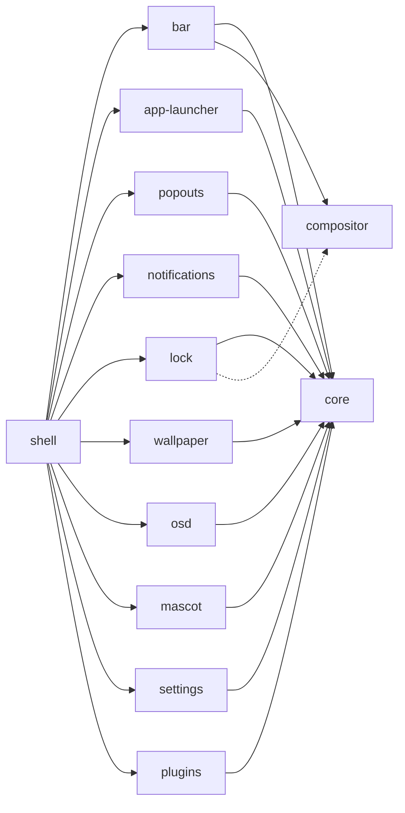

<h1 align="center">twilight-shell</h1>

<p align="center">
A desktop shell for Wayland, made of pieces that each live in their own repository and install on their own.<br>
Built with <a href="https://quickshell.org">Quickshell</a>, painted like a night sky over Ponyville.
</p>

<p align="center">
  <a href="https://github.com/twilight-shell/shell/actions/workflows/ci.yml"></a>
  <a href="https://github.com/twilight-shell/shell/releases"></a>
  <a href="LICENSE"></a>
</p>

<!-- lang:start -->
<p align="center">
  <b>English</b> ·
  <a href="i18n/README/README.ru.md">Русский</a> ·
  <a href="i18n/README/README.uk.md">Українська</a> ·
  <a href="i18n/README/README.de.md">Deutsch</a> ·
  <a href="i18n/README/README.fr.md">Français</a> ·
  <a href="i18n/README/README.es.md">Español</a> ·
  <a href="i18n/README/README.pt-BR.md">Português</a> ·
  <a href="i18n/README/README.it.md">Italiano</a> ·
  <a href="i18n/README/README.zh-CN.md">简体中文</a> ·
  <a href="i18n/README/README.ja.md">日本語</a> ·
  <a href="i18n/README/README.ko.md">한국어</a>
</p>
<!-- lang:end -->

<p align="center">
  
</p>

## Contents

<!-- toc:start -->
- [What it is](#what-it-is)
- [Preview](#preview)
- [Screenshots](#screenshots)
  - [The bar](#the-bar)
  - [The launcher](#the-launcher)
  - [Popouts](#popouts)
  - [Notifications and the volume pop-up](#notifications-and-the-volume-pop-up)
  - [The lock screen](#the-lock-screen)
  - [The mascot](#the-mascot)
  - [The wallpaper and the palettes](#the-wallpaper-and-the-palettes)
  - [The settings window](#the-settings-window)
  - [Plugins](#plugins)
- [Requirements](#requirements)
- [Installing](#installing)
- [Running](#running)
- [Using it](#using-it)
- [Settings](#settings)
- [Components](#components)
- [Plugins](#plugins-1)
- [Troubleshooting](#troubleshooting)
- [Updating](#updating)
- [Contributing](#contributing)
- [Credits](#credits)
- [License](#license)
<!-- toc:end -->

## What it is

A bar, a launcher, notifications, a lock screen, a wallpaper, a mascot, a settings
window and plugins, all drawn in one sticker style that follows a single palette.

- **Pieces, not a block.** Every component is a repository of its own that works on its own
  and installs on its own. Want only the launcher? Install only the launcher. Don't like
  the bar? Leave it out. This repository only puts them together.
- **Settings are plain TOML files** in `~/.config/twilight-shell/`, made from the defaults the first
  time a component runs, applied the moment you save them. Or use the settings window.
- **Extensible.** A plugin is a folder with a `plugin.toml` and some QML. It can draw windows,
  answer IPC calls, put an island in the bar and get a page in the settings window.
- **Not tied to one compositor.** It runs on [niri](https://github.com/YaLTeR/niri) today. Everything that
  talks to the compositor goes through one small module, so others can follow.

## Preview

<p align="center">
  <a href="docs/media/preview.mp4"></a>
</p>

A short tour: the launcher, the calendar and the sound mixer, notifications, the volume pop-up,
the settings window and the lock screen. Click the picture to play it.

## Screenshots

### The bar

Floating islands along the top of every screen: the launcher button, the workspaces, the focused window,
a clock (24-hour or AM/PM, with or without seconds), the keyboard layout, the tray and the volume.
Plugins can add islands of their own.


### The launcher

"Twilight's Library": a spellbook card over a night sky. Type to search, and it still finds Firefox when you
typed it on the wrong keyboard layout.


### Popouts

Cards that drop out of the bar: a calendar with the phase of the moon under the clock, and a sound mixer
under the volume with every output, input and app.

 

### Notifications and the volume pop-up

The notification daemon: actions, urgency, a fuse that burns down while a card is shown, and cards that make way
for the popouts. And the pop-up that rises from the bottom edge when the volume changes.


 

### The lock screen

A process of its own that exists only while the session is locked: the password goes through PAM, the keyboard
layout is shown so you don't type it in the wrong one, and a wrong password shakes the card.


### The mascot

Twilight lives in a corner of the screen. She strolls along the bottom edge, talks in a bubble, dances when music
plays, dozes off late at night and can be picked up and thrown. Her sprites are not part of the repository:
the [mascot](https://github.com/twilight-shell/mascot) repository has a script that fetches them, with the credits.

 

### The wallpaper and the palettes

A picture revealed through a growing circle, or an LED wall of drifting, twinkling stars in the palette's colors.
The palette is one of the ready ones, one of your own, or the colors of the wallpaper:

  
  
  

### The settings window

A page for every component that describes its settings: there is nothing to register, and a plugin gets
its page the same way. The palette page lets you make a palette of your own with a color picker.

 
 
 

### Plugins

 

## Requirements

- [Quickshell](https://quickshell.org) 0.3 or newer (it brings Qt 6).
- A Wayland compositor. The workspaces, the focused window and the keyboard layout are
  known for [niri](https://github.com/YaLTeR/niri) so far; the lock screen needs `ext-session-lock-v1`
  (niri, Hyprland, Sway and others have it).
- PipeWire, for the sound mixer, the volume pop-up and the volume island.
- PAM, for the lock screen.
- `git` and `make` to install it from a checkout.
- Optional: the [Monocraft](https://github.com/IdreesInc/Monocraft) Nerd Font (the system font is used without it)
  and `curl`, for the script that fetches the mascot's sprites.

## Installing

Everything, with the shell that puts it together:

```sh
git clone --recurse-submodules git@github.com:twilight-shell/shell.git
cd shell
sudo make install        # the modules to /usr/lib/qt6/qml, twilight-shell to /usr/bin
```

`make install PREFIX=~/.local QMLDIR=~/.local/lib/qt6/qml` puts everything in your home directory instead.

To install only some of the components, say which, and what they need comes with them:

```sh
sudo make install ONLY="bar"                 # the bar, with core and compositor
sudo make install ONLY="app-launcher lock"   # two, with core
```

Without the shell that puts them together (no `twilight-shell`, no `shell.qml`), each runs on its own:
`qs -p /path/to/bar`. What a component needs is in the `DEPENDS` file of its repository, and its own
`make install` says so when something is missing.

To try it without installing, run it from the checkout: `bin/twilight-shell`.

## Running

Start it with your session. In niri:

```kdl
spawn-at-startup "twilight-shell"

binds {
    Mod+P repeat=false { spawn "twilight-shell" "ipc" "call" "launcher" "toggle"; }
    Mod+S repeat=false { spawn "twilight-shell" "ipc" "call" "settings" "toggle"; }
    Mod+Alt+Shift+L repeat=false { spawn "twilight-shell" "lock"; }
}
```

The shell is the notification daemon, and only one daemon can own the name on the session bus:
stop mako, dunst and the like when you switch to it.

On NVIDIA, start it with `__GL_YIELD=USLEEP` in the environment (`spawn-at-startup "env" "__GL_YIELD=USLEEP" "twilight-shell"`):
the driver otherwise busy-waits on the GPU and burns CPU on every frame.

The first start makes a settings file for each component in `~/.config/twilight-shell/`. Pictures for the
wallpaper go in `~/Pictures/Wallpapers`. For the mascot, fetch her sprites once:

```sh
modules/mascot/scripts/get-sprites.sh        # from the checkout; the folder can be changed in mascot.toml
```

## Using it

`twilight-shell ipc call ...` talks to the shell that runs.

| | |
|---|---|
| `launcher toggle` | Open and close the launcher. |
| `popout toggle calendar` | The calendar; `sound` for the mixer. |
| `settings toggle` | The settings window; `settings open <tab>` opens a tab. |
| `wallpaper next` | The next picture; `prev`, `set <path>`, `palette <name>`, `live stars` (or `live ""`). |
| `mascot toggle` | Send her out of sight and back; `mascot say <text>` makes her talk. |
| `plugins list` | The plugins and what is wrong with them; `plugins scan`, `plugins reload`. |

Other commands of the launcher script:

| | |
|---|---|
| `twilight-shell lock` | Lock the session. A process of its own that exits when you unlock. |
| `twilight-shell lock preview` | Show the lock screen without locking anything. Esc closes it. |
| `twilight-shell config init` | Make the settings file of every component that has none yet. |

## Settings

One TOML file per component in `~/.config/twilight-shell/`, applied as soon as it is saved. Comments and layout
survive when the shell writes a value back. The window and the files edit the same thing.

| File | What is in it |
|---|---|
| `theme.toml` | `palette` (a preset, `wallpaper`, or one of yours), `wallpaper`, and your own `[palettes.<name>]`. |
| `bar.toml` | `window-title`, and `[clock]` with `hour24` and `seconds`. |
| `app-launcher.toml` | `terminal`, the command that runs terminal apps. |
| `lock.toml` | `pam`, the PAM service the password is checked against. |
| `wallpaper.toml` | `dir`, `live`, and `[stars]` with `dot`, `cell`, `speed` and `glow`. |
| `mascot.toml` | `enabled`, `sprites`, `music`, `sleep`, `chatter`. |
| `plugins.toml` | `dirs`, where plugins are looked for, and `enabled`, the ones that run. |

A palette of your own is a table in `theme.toml`:

```toml
palette = "mine"

[palettes.mine]
name = "Mine"
base = "#2a4b3a"        # tints the background and the surfaces
primary = "#9be3b0"     # primary, accent and secondary are used as they are
accent = "#f2b84b"
secondary = "#3f8f7a"
```

Every component keeps its keys in its README.

## Components

Every component is its own repository, versioned on its own. This repository points each one at the commit
that was tested with the rest.



| | |
|---|---|
| [core](https://github.com/twilight-shell/core) | The theme, the palettes, the sticker UI kit, the settings files. Every other component needs it. |
| [compositor](https://github.com/twilight-shell/compositor) | Workspaces, the focused window and the keyboard layout, the same for every compositor (niri so far). |
| [bar](https://github.com/twilight-shell/bar) | The bar. |
| [app-launcher](https://github.com/twilight-shell/app-launcher) | "Twilight's Library", the app launcher. |
| [popouts](https://github.com/twilight-shell/popouts) | The calendar and the sound mixer that drop from the bar. |
| [notifications](https://github.com/twilight-shell/notifications) | The notification daemon and its cards. |
| [lock](https://github.com/twilight-shell/lock) | The lock screen. |
| [wallpaper](https://github.com/twilight-shell/wallpaper) | The wallpaper, a picture or live stars. |
| [osd](https://github.com/twilight-shell/osd) | The volume pop-up. |
| [mascot](https://github.com/twilight-shell/mascot) | Twilight herself, strolling along the bottom edge. Her sprites are downloaded separately. |
| [settings](https://github.com/twilight-shell/settings) | The settings window: palettes of your own, and a page for every component that describes its settings. |
| [plugins](https://github.com/twilight-shell/plugins) | Finds the plugins and runs the ones that are switched on. |
| [plugin-template](https://github.com/twilight-shell/plugin-template) | A plugin to start from. |

## Plugins

A plugin is a folder with a `plugin.toml` and some QML. It can draw windows, answer IPC calls, put an island in the bar
and have a page in the settings window. Nothing runs until you switch it on in the settings window or in
`plugins.toml`. Start from the [plugin-template](https://github.com/twilight-shell/plugin-template), and read how it
all works in [plugins](https://github.com/twilight-shell/plugins).

```sh
git clone git@github.com:twilight-shell/plugin-template.git ~/.local/share/twilight-shell/plugins/my-plugin
```

A plugin is code that runs with your rights, and there is no sandbox. Switch on only the ones you trust.

## Troubleshooting

**`module "Twilight.Core" is not installed`.** The module isn't in a folder Qt searches. Run from a checkout with
`bin/twilight-shell` (it sets the path up), install the modules (`make install`), or point `QML_IMPORT_PATH` at the
parent folders of the modules, as full paths separated by `:`. In fish, write `$HOME`: it doesn't expand `~` after a colon.

**No notifications, or they come from another program.** Only one daemon can own `org.freedesktop.Notifications`.
Stop mako, dunst and the like; mako comes back by itself through D-Bus activation when the name is free, so remove
its autostart. See who has the name: `busctl --user list | grep Notifications`.

**The CPU is busy on NVIDIA.** Start the shell with `__GL_YIELD=USLEEP` in the environment.

**The mascot doesn't show up.** She needs her sprites: run `modules/mascot/scripts/get-sprites.sh` (or the one in the
mascot repository) and check `sprites` in `mascot.toml`.

**A component has no page in the settings window.** The window finds the `*.schema.toml` files of the components on
`QML_IMPORT_PATH` and in the folder the modules are installed in. A component without a schema has no page.

**A new component or plugin doesn't appear.** The list of module folders is read when the shell starts: restart it.
A plugin folder that is added or removed is noticed by itself; `twilight-shell ipc call plugins list` says what it sees.

**The screen stays locked.** If the lock process dies, the compositor keeps the session locked, which is the point.
Switch to a TTY (Ctrl+Alt+F2), log in, and start a locker for that session, or restart the compositor.

## Updating

```sh
git pull --recurse-submodules
sudo make install
qs -p /usr/share/twilight-shell kill && twilight-shell
```

Each repository is versioned on its own ([Semantic Versioning](https://semver.org), a tag `v0.1.0` for each
release, a `CHANGELOG.md` that says what is in it). A release of the shell is a set of components that were tested
together: the submodules point at their commits, and this shows which versions they are:

```sh
git submodule foreach 'git describe --tags --always'
```

To remove it: `sudo make uninstall`.

## Contributing

Bug reports, ideas, documentation and plugins are all welcome. Read [CONTRIBUTING.md](CONTRIBUTING.md), and
[AGENTS.md](AGENTS.md) if you are an agent. We follow the
[Code of Conduct](https://github.com/twilight-shell/.github/blob/main/CODE_OF_CONDUCT.md); security problems are
reported privately, see [SECURITY.md](https://github.com/twilight-shell/.github/blob/main/SECURITY.md).

## Credits

The mascot's sprites aren't part of this project: the `get-sprites.sh` script of the mascot repository downloads
Twilight Sparkle's from [Desktop Ponies](https://github.com/RoosterDragon/Desktop-Ponies), the work of RoosterDragon
and the many artists who drew and shared them under CC BY-NC-SA 3.0
([credits](https://github.com/RoosterDragon/Desktop-Ponies/blob/master/Content/credits.txt)). Thank you.
My Little Pony: Friendship is Magic is © Hasbro; this project isn't affiliated with or endorsed by Hasbro or
Desktop Ponies. The font is [Monocraft](https://github.com/IdreesInc/Monocraft), patched with Nerd Font symbols.

## License

MIT, see [LICENSE](LICENSE). The sprites keep their own license, CC BY-NC-SA 3.0.
