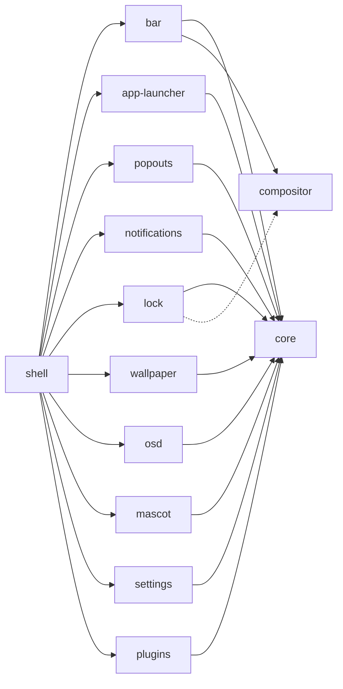

<h1 align="center">twilight-shell</h1>

<p align="center">
Eine Desktop-Shell für Wayland, zusammengesetzt aus Teilen, die jeweils in einem eigenen Repository leben und einzeln installiert werden.<br> Gebaut mit <a href="https://quickshell.org">Quickshell</a>, gemalt wie ein Nachthimmel über Ponyville.
</p>

<p align="center">
  <a href="https://github.com/twilight-shell/shell/actions/workflows/ci.yml"></a>
  <a href="https://github.com/twilight-shell/shell/releases"></a>
  <a href="../../LICENSE"></a>
</p>

<!-- lang:start -->
<p align="center">
  <a href="../../README.md">English</a> ·
  <a href="README.ru.md">Русский</a> ·
  <a href="README.uk.md">Українська</a> ·
  <b>Deutsch</b> ·
  <a href="README.fr.md">Français</a> ·
  <a href="README.es.md">Español</a> ·
  <a href="README.pt-BR.md">Português</a> ·
  <a href="README.it.md">Italiano</a> ·
  <a href="README.zh-CN.md">简体中文</a> ·
  <a href="README.ja.md">日本語</a> ·
  <a href="README.ko.md">한국어</a>
</p>
<!-- lang:end -->

<p align="center">
  
</p>

## Inhalt

<!-- toc:start -->
- [Was es ist](#was-es-ist)
- [Vorschau](#vorschau)
- [Screenshots](#screenshots)
  - [Die Leiste](#die-leiste)
  - [Der Launcher](#der-launcher)
  - [Popouts](#popouts)
  - [Benachrichtigungen und die Lautstärkeanzeige](#benachrichtigungen-und-die-lautstärkeanzeige)
  - [Der Sperrbildschirm](#der-sperrbildschirm)
  - [Das Maskottchen](#das-maskottchen)
  - [Das Hintergrundbild und die Paletten](#das-hintergrundbild-und-die-paletten)
  - [Das Einstellungsfenster](#das-einstellungsfenster)
  - [Plugins](#plugins)
- [Voraussetzungen](#voraussetzungen)
- [Installation](#installation)
- [Starten](#starten)
- [Benutzung](#benutzung)
- [Einstellungen](#einstellungen)
- [Komponenten](#komponenten)
- [Plugins](#plugins-1)
- [Fehlerbehebung](#fehlerbehebung)
- [Aktualisieren](#aktualisieren)
- [Mitmachen](#mitmachen)
- [Danksagung](#danksagung)
- [Lizenz](#lizenz)
<!-- toc:end -->

## Was es ist

Eine Leiste, ein Launcher, Benachrichtigungen, ein Sperrbildschirm, ein Hintergrundbild, ein Maskottchen, ein Einstellungsfenster und Plugins, alle im selben Aufkleber-Stil gezeichnet, der einer einzigen Palette folgt.

- **Teile statt Block.** Jede Komponente ist ein eigenes Repository, das für sich funktioniert und für sich installiert wird. Du willst nur den Launcher? Installiere nur den Launcher. Die Leiste gefällt dir nicht? Lass sie weg. Dieses Repository fügt sie nur zusammen.
- **Einstellungen sind einfache TOML-Dateien** in `~/.config/twilight-shell/`, beim ersten Lauf einer Komponente aus den Standardwerten erzeugt und im Moment des Speicherns übernommen. Oder nutze das Einstellungsfenster.
- **Erweiterbar.** Ein Plugin ist ein Ordner mit einer `plugin.toml` und etwas QML. Es kann Fenster zeichnen, IPC-Aufrufe beantworten, eine Insel in die Leiste setzen und eine Seite im Einstellungsfenster bekommen.
- **Nicht an einen Compositor gebunden.** Heute läuft es auf [niri](https://github.com/YaLTeR/niri). Alles, was mit dem Compositor spricht, geht durch ein kleines Modul, sodass andere folgen können.

## Vorschau

<p align="center">
  <a href="../../docs/media/preview.mp4"></a>
</p>

Eine kurze Tour: der Launcher, der Kalender und der Soundmixer, Benachrichtigungen, die Lautstärkeanzeige, das Einstellungsfenster und der Sperrbildschirm. Klicke auf das Bild, um das Video abzuspielen.

## Screenshots

### Die Leiste

Schwebende Inseln am oberen Rand jedes Bildschirms: die Launcher-Schaltfläche, die Arbeitsflächen, das fokussierte Fenster, eine Uhr (24 Stunden oder AM/PM, mit oder ohne Sekunden), das Tastaturlayout, das Tray und die Lautstärke. Plugins können eigene Inseln hinzufügen.


### Der Launcher

„Twilight's Library“: eine Zauberbuch-Karte vor einem Nachthimmel. Tippe zum Suchen, und er findet Firefox sogar, wenn du es im falschen Tastaturlayout getippt hast.


### Popouts

Karten, die aus der Leiste herausfallen: ein Kalender mit der Mondphase unter der Uhr und ein Soundmixer unter der Lautstärke mit jedem Ausgang, Eingang und jeder App.

 

### Benachrichtigungen und die Lautstärkeanzeige

Der Benachrichtigungsdienst: Aktionen, Dringlichkeit, eine Lunte, die abbrennt, solange eine Karte angezeigt wird, und Karten, die den Popouts Platz machen. Dazu die Anzeige, die vom unteren Rand aufsteigt, wenn sich die Lautstärke ändert.


 

### Der Sperrbildschirm

Ein eigener Prozess, der nur existiert, solange die Sitzung gesperrt ist: Das Passwort wird über PAM geprüft, das Tastaturlayout wird angezeigt, damit du es nicht im falschen tippst, und ein falsches Passwort lässt die Karte wackeln.


### Das Maskottchen

Twilight lebt in einer Ecke des Bildschirms. Sie spaziert am unteren Rand entlang, spricht in einer Sprechblase, tanzt, wenn Musik läuft, nickt spät in der Nacht ein und lässt sich aufheben und werfen. Ihre Sprites gehören nicht zum Repository: Das Repository [mascot](https://github.com/twilight-shell/mascot) hat ein Skript, das sie herunterlädt, samt Quellenangaben.

 

### Das Hintergrundbild und die Paletten

Ein Bild, das durch einen wachsenden Kreis enthüllt wird, oder eine LED-Wand aus treibenden, funkelnden Sternen in den Farben der Palette. Die Palette ist eine der fertigen, eine eigene oder die Farben des Hintergrundbilds:

  
  
  

### Das Einstellungsfenster

Eine Seite für jede Komponente, die ihre Einstellungen beschreibt: Es muss nichts registriert werden, und ein Plugin bekommt seine Seite auf dieselbe Weise. Auf der Palettenseite kannst du mit einem Farbwähler eine eigene Palette erstellen.

 
 
 

### Plugins

 

## Voraussetzungen

- [Quickshell](https://quickshell.org) 0.3 oder neuer (es bringt Qt 6 mit).
- Ein Wayland-Compositor. Die Arbeitsflächen, das fokussierte Fenster und das Tastaturlayout sind bisher für [niri](https://github.com/YaLTeR/niri) bekannt; der Sperrbildschirm braucht `ext-session-lock-v1` (niri, Hyprland, Sway und andere haben es).
- PipeWire, für den Soundmixer, die Lautstärkeanzeige und die Lautstärke-Insel.
- PAM, für den Sperrbildschirm.
- `git` und `make`, um es aus einem Checkout zu installieren.
- Optional: die [Monocraft](https://github.com/IdreesInc/Monocraft) Nerd Font (ohne sie wird die Systemschrift verwendet) und `curl` für das Skript, das die Sprites des Maskottchens herunterlädt.

## Installation

Alles, mit der Shell, die es zusammensetzt:

```sh
git clone --recurse-submodules git@github.com:twilight-shell/shell.git
cd shell
sudo make install        # the modules to /usr/lib/qt6/qml, twilight-shell to /usr/bin
```

`make install PREFIX=~/.local QMLDIR=~/.local/lib/qt6/qml` legt stattdessen alles in dein Home-Verzeichnis.

Um nur einige der Komponenten zu installieren, sag welche, und was sie brauchen, kommt mit:

```sh
sudo make install ONLY="bar"                 # the bar, with core and compositor
sudo make install ONLY="app-launcher lock"   # two, with core
```

Ohne die Shell, die sie zusammensetzt (kein `twilight-shell`, keine `shell.qml`), läuft jede für sich: `qs -p /path/to/bar`. Was eine Komponente braucht, steht in der Datei `DEPENDS` ihres Repositorys, und ihr eigenes `make install` sagt es, wenn etwas fehlt.

Zum Ausprobieren ohne Installation starte aus dem Checkout: `bin/twilight-shell`.

## Starten

Starte es mit deiner Sitzung. In niri:

```kdl
spawn-at-startup "twilight-shell"

binds {
    Mod+P repeat=false { spawn "twilight-shell" "ipc" "call" "launcher" "toggle"; }
    Mod+S repeat=false { spawn "twilight-shell" "ipc" "call" "settings" "toggle"; }
    Mod+Alt+Shift+L repeat=false { spawn "twilight-shell" "lock"; }
}
```

Die Shell ist der Benachrichtigungsdienst, und nur ein Dienst kann den Namen auf dem Sitzungsbus besitzen: Beende mako, dunst und Ähnliches, wenn du darauf umsteigst.

Auf NVIDIA starte sie mit `__GL_YIELD=USLEEP` in der Umgebung (`spawn-at-startup "env" "__GL_YIELD=USLEEP" "twilight-shell"`): Der Treiber wartet sonst aktiv auf die GPU und verbraucht bei jedem Frame CPU.

Beim ersten Start wird für jede Komponente eine Einstellungsdatei in `~/.config/twilight-shell/` erzeugt. Bilder für den Hintergrund kommen nach `~/Pictures/Wallpapers`. Für das Maskottchen lade einmal ihre Sprites herunter:

```sh
modules/mascot/scripts/get-sprites.sh        # from the checkout; the folder can be changed in mascot.toml
```

## Benutzung

`twilight-shell ipc call ...` spricht mit der laufenden Shell.

| | |
|---|---|
| `launcher toggle` | Den Launcher öffnen und schließen. |
| `popout toggle calendar` | Der Kalender; `sound` für den Mixer. |
| `settings toggle` | Das Einstellungsfenster; `settings open <tab>` öffnet einen Tab. |
| `wallpaper next` | Das nächste Bild; `prev`, `set <path>`, `palette <name>`, `live stars` (oder `live ""`). |
| `mascot toggle` | Sie aus dem Blickfeld schicken und zurück; `mascot say <text>` lässt sie sprechen. |
| `plugins list` | Die Plugins und was mit ihnen nicht stimmt; `plugins scan`, `plugins reload`. |

Weitere Befehle des Startskripts:

| | |
|---|---|
| `twilight-shell lock` | Die Sitzung sperren. Ein eigener Prozess, der sich beendet, wenn du entsperrst. |
| `twilight-shell lock preview` | Den Sperrbildschirm zeigen, ohne etwas zu sperren. Esc schließt ihn. |
| `twilight-shell config init` | Die Einstellungsdatei jeder Komponente anlegen, die noch keine hat. |

## Einstellungen

Eine TOML-Datei pro Komponente in `~/.config/twilight-shell/`, übernommen, sobald sie gespeichert wird. Kommentare und Layout bleiben erhalten, wenn die Shell einen Wert zurückschreibt. Das Fenster und die Dateien bearbeiten dasselbe.

| Datei | Was drinsteht |
|---|---|
| `theme.toml` | `palette` (eine fertige, `wallpaper` oder eine von dir), `wallpaper` und deine eigenen `[palettes.<name>]`. |
| `bar.toml` | `window-title` und `[clock]` mit `hour24` und `seconds`. |
| `app-launcher.toml` | `terminal`, der Befehl, der Terminal-Apps startet. |
| `lock.toml` | `pam`, der PAM-Dienst, gegen den das Passwort geprüft wird. |
| `wallpaper.toml` | `dir`, `live` und `[stars]` mit `dot`, `cell`, `speed` und `glow`. |
| `mascot.toml` | `enabled`, `sprites`, `music`, `sleep`, `chatter`. |
| `plugins.toml` | `dirs`, wo nach Plugins gesucht wird, und `enabled`, welche laufen. |

Eine eigene Palette ist eine Tabelle in `theme.toml`:

```toml
palette = "mine"

[palettes.mine]
name = "Mine"
base = "#2a4b3a"        # tints the background and the surfaces
primary = "#9be3b0"     # primary, accent and secondary are used as they are
accent = "#f2b84b"
secondary = "#3f8f7a"
```

Jede Komponente beschreibt ihre Schlüssel in ihrer README.

## Komponenten

Jede Komponente ist ein eigenes Repository mit eigener Version. Dieses Repository verweist bei jeder auf den Commit, der mit den übrigen getestet wurde.



| | |
|---|---|
| [core](https://github.com/twilight-shell/core) | Das Theme, die Paletten, das Aufkleber-UI-Kit, die Einstellungsdateien. Jede andere Komponente braucht es. |
| [compositor](https://github.com/twilight-shell/compositor) | Arbeitsflächen, das fokussierte Fenster und das Tastaturlayout, für jeden Compositor gleich (bisher niri). |
| [bar](https://github.com/twilight-shell/bar) | Die Leiste. |
| [app-launcher](https://github.com/twilight-shell/app-launcher) | „Twilight's Library“, der App-Launcher. |
| [popouts](https://github.com/twilight-shell/popouts) | Der Kalender und der Soundmixer, die aus der Leiste herausfallen. |
| [notifications](https://github.com/twilight-shell/notifications) | Der Benachrichtigungsdienst und seine Karten. |
| [lock](https://github.com/twilight-shell/lock) | Der Sperrbildschirm. |
| [wallpaper](https://github.com/twilight-shell/wallpaper) | Das Hintergrundbild, ein Bild oder lebende Sterne. |
| [osd](https://github.com/twilight-shell/osd) | Die Lautstärkeanzeige. |
| [mascot](https://github.com/twilight-shell/mascot) | Twilight selbst, die am unteren Rand entlangspaziert. Ihre Sprites werden separat heruntergeladen. |
| [settings](https://github.com/twilight-shell/settings) | Das Einstellungsfenster: eigene Paletten und eine Seite für jede Komponente, die ihre Einstellungen beschreibt. |
| [plugins](https://github.com/twilight-shell/plugins) | Findet die Plugins und führt die eingeschalteten aus. |
| [plugin-template](https://github.com/twilight-shell/plugin-template) | Ein Plugin als Ausgangspunkt. |

## Plugins

Ein Plugin ist ein Ordner mit einer `plugin.toml` und etwas QML. Es kann Fenster zeichnen, IPC-Aufrufe beantworten, eine Insel in die Leiste setzen und eine Seite im Einstellungsfenster haben. Nichts läuft, bis du es im Einstellungsfenster oder in `plugins.toml` einschaltest. Beginne mit dem [plugin-template](https://github.com/twilight-shell/plugin-template) und lies in [plugins](https://github.com/twilight-shell/plugins), wie alles funktioniert.

```sh
git clone git@github.com:twilight-shell/plugin-template.git ~/.local/share/twilight-shell/plugins/my-plugin
```

Ein Plugin ist Code, der mit deinen Rechten läuft, und es gibt keine Sandbox. Schalte nur die ein, denen du vertraust.

## Fehlerbehebung

**`module "Twilight.Core" is not installed`.** Das Modul liegt nicht in einem Ordner, den Qt durchsucht. Starte aus einem Checkout mit `bin/twilight-shell` (es richtet den Pfad ein), installiere die Module (`make install`) oder setze `QML_IMPORT_PATH` auf die übergeordneten Ordner der Module, als vollständige Pfade, getrennt durch `:`. In fish schreibe `$HOME`: Es expandiert `~` nach einem Doppelpunkt nicht.

**Keine Benachrichtigungen, oder sie kommen von einem anderen Programm.** Nur ein Dienst kann `org.freedesktop.Notifications` besitzen. Beende mako, dunst und Ähnliches; mako kommt über die D-Bus-Aktivierung von selbst zurück, wenn der Name frei ist, entferne also seinen Autostart. Wer den Namen hat: `busctl --user list | grep Notifications`.

**Die CPU ist unter NVIDIA ausgelastet.** Starte die Shell mit `__GL_YIELD=USLEEP` in der Umgebung.

**Das Maskottchen erscheint nicht.** Sie braucht ihre Sprites: Führe `modules/mascot/scripts/get-sprites.sh` aus (oder das aus dem mascot-Repository) und prüfe `sprites` in `mascot.toml`.

**Eine Komponente hat keine Seite im Einstellungsfenster.** Das Fenster findet die `*.schema.toml`-Dateien der Komponenten in `QML_IMPORT_PATH` und im Ordner, in den die Module installiert sind. Eine Komponente ohne Schema hat keine Seite.

**Eine neue Komponente oder ein neues Plugin erscheint nicht.** Die Liste der Modulordner wird beim Start der Shell gelesen: Starte sie neu. Ein hinzugefügter oder entfernter Plugin-Ordner wird von selbst bemerkt; `twilight-shell ipc call plugins list` zeigt, was sie sieht.

**Der Bildschirm bleibt gesperrt.** Wenn der Sperrprozess stirbt, hält der Compositor die Sitzung gesperrt, das ist der Sinn. Wechsle zu einem TTY (Strg+Alt+F2), melde dich an und starte einen Sperrer für diese Sitzung, oder starte den Compositor neu.

## Aktualisieren

```sh
git pull --recurse-submodules
sudo make install
qs -p /usr/share/twilight-shell kill && twilight-shell
```

Jedes Repository hat seine eigene Version ([Semantic Versioning](https://semver.org), ein Tag `v0.1.0` für jedes Release, ein `CHANGELOG.md`, das sagt, was drin ist). Ein Release der Shell ist ein Satz von Komponenten, die zusammen getestet wurden: Die Submodule zeigen auf ihre Commits, und dies zeigt, welche Versionen es sind:

```sh
git submodule foreach 'git describe --tags --always'
```

Zum Entfernen: `sudo make uninstall`.

## Mitmachen

Fehlerberichte, Ideen, Dokumentation und Plugins sind alle willkommen. Lies [CONTRIBUTING.md](../../CONTRIBUTING.md) und, wenn du ein Agent bist, [AGENTS.md](../../AGENTS.md). Wir folgen dem [Verhaltenskodex](https://github.com/twilight-shell/.github/blob/main/CODE_OF_CONDUCT.md); Sicherheitsprobleme werden privat gemeldet, siehe [SECURITY.md](https://github.com/twilight-shell/.github/blob/main/SECURITY.md).

## Danksagung

Die Sprites des Maskottchens gehören nicht zu diesem Projekt: Das Skript `get-sprites.sh` des mascot-Repositorys lädt die von Twilight Sparkle aus [Desktop Ponies](https://github.com/RoosterDragon/Desktop-Ponies) herunter, die Arbeit von RoosterDragon und den vielen Künstlern, die sie gezeichnet und unter CC BY-NC-SA 3.0 geteilt haben ([Credits](https://github.com/RoosterDragon/Desktop-Ponies/blob/master/Content/credits.txt)). Danke. My Little Pony: Friendship is Magic ist © Hasbro; dieses Projekt ist weder mit Hasbro oder Desktop Ponies verbunden noch von ihnen unterstützt. Die Schrift ist [Monocraft](https://github.com/IdreesInc/Monocraft), mit Nerd-Font-Symbolen gepatcht.

## Lizenz

MIT, siehe [LICENSE](../../LICENSE). Die Sprites behalten ihre eigene Lizenz, CC BY-NC-SA 3.0.
