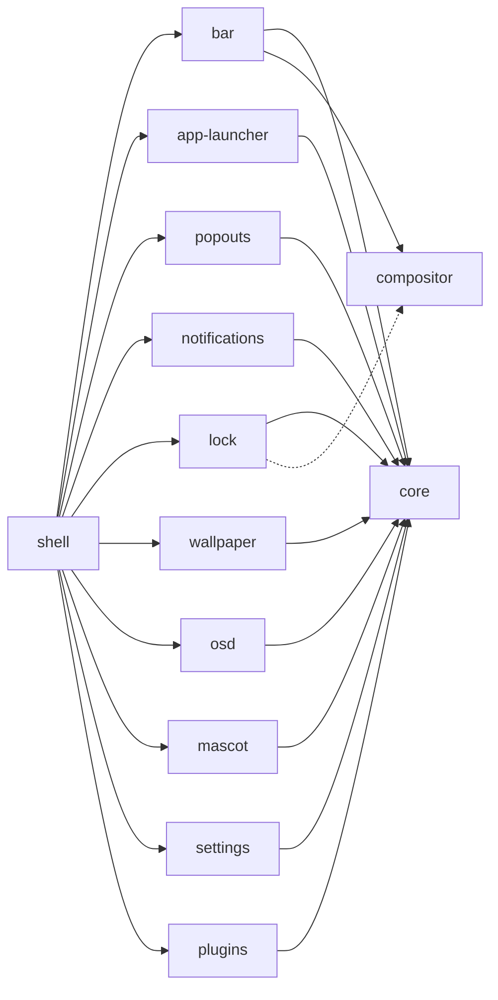

<h1 align="center">twilight-shell</h1>

<p align="center">
Un escritorio para Wayland hecho de piezas que viven cada una en su propio repositorio y se instalan por separado.<br> Construido con <a href="https://quickshell.org">Quickshell</a>, pintado como un cielo nocturno sobre Ponyville.
</p>

<p align="center">
  <a href="https://github.com/twilight-shell/shell/actions/workflows/ci.yml"></a>
  <a href="https://github.com/twilight-shell/shell/releases"></a>
  <a href="../../LICENSE"></a>
</p>

<!-- lang:start -->
<p align="center">
  <a href="../../README.md">English</a> ·
  <a href="README.ru.md">Русский</a> ·
  <a href="README.uk.md">Українська</a> ·
  <a href="README.de.md">Deutsch</a> ·
  <a href="README.fr.md">Français</a> ·
  <b>Español</b> ·
  <a href="README.pt-BR.md">Português</a> ·
  <a href="README.it.md">Italiano</a> ·
  <a href="README.zh-CN.md">简体中文</a> ·
  <a href="README.ja.md">日本語</a> ·
  <a href="README.ko.md">한국어</a>
</p>
<!-- lang:end -->

<p align="center">
  
</p>

## Contenido

<!-- toc:start -->
- [Qué es](#qué-es)
- [Vista previa](#vista-previa)
- [Capturas de pantalla](#capturas-de-pantalla)
  - [La barra](#la-barra)
  - [El lanzador](#el-lanzador)
  - [Tarjetas emergentes](#tarjetas-emergentes)
  - [Notificaciones y el indicador de volumen](#notificaciones-y-el-indicador-de-volumen)
  - [La pantalla de bloqueo](#la-pantalla-de-bloqueo)
  - [La mascota](#la-mascota)
  - [El fondo de pantalla y las paletas](#el-fondo-de-pantalla-y-las-paletas)
  - [La ventana de ajustes](#la-ventana-de-ajustes)
  - [Plugins](#plugins)
- [Requisitos](#requisitos)
- [Instalación](#instalación)
- [Ejecución](#ejecución)
- [Uso](#uso)
- [Ajustes](#ajustes)
- [Componentes](#componentes)
- [Plugins](#plugins-1)
- [Solución de problemas](#solución-de-problemas)
- [Actualización](#actualización)
- [Contribuir](#contribuir)
- [Créditos](#créditos)
- [Licencia](#licencia)
<!-- toc:end -->

## Qué es

Una barra, un lanzador, notificaciones, una pantalla de bloqueo, un fondo de pantalla, una mascota, una ventana de ajustes y plugins, todo dibujado en el mismo estilo de pegatinas que sigue una única paleta.

- **Piezas, no un bloque.** Cada componente es un repositorio propio que funciona por sí solo y se instala por sí solo. ¿Solo quieres el lanzador? Instala solo el lanzador. ¿No te gusta la barra? Déjala fuera. Este repositorio solo las junta.
- **Los ajustes son archivos TOML sencillos** en `~/.config/twilight-shell/`, creados a partir de los valores por defecto la primera vez que se ejecuta un componente y aplicados en cuanto los guardas. O usa la ventana de ajustes.
- **Extensible.** Un plugin es una carpeta con un `plugin.toml` y algo de QML. Puede dibujar ventanas, responder a llamadas IPC, poner una isla en la barra y tener una página en la ventana de ajustes.
- **No atado a un solo compositor.** Hoy funciona en [niri](https://github.com/YaLTeR/niri). Todo lo que habla con el compositor pasa por un módulo pequeño, así que otros pueden seguir.

## Vista previa

<p align="center">
  <a href="../../docs/media/preview.mp4"></a>
</p>

Un breve recorrido: el lanzador, el calendario y el mezclador de sonido, las notificaciones, el indicador de volumen, la ventana de ajustes y la pantalla de bloqueo. Haz clic en la imagen para reproducirlo.

## Capturas de pantalla

### La barra

Islas flotantes a lo largo del borde superior de cada pantalla: el botón del lanzador, los espacios de trabajo, la ventana enfocada, un reloj (de 24 horas o AM/PM, con o sin segundos), la distribución del teclado, la bandeja y el volumen. Los plugins pueden añadir islas propias.


### El lanzador

«Twilight's Library»: una tarjeta de libro de hechizos sobre un cielo nocturno. Escribe para buscar, y encuentra Firefox incluso si lo escribiste con la distribución de teclado equivocada.


### Tarjetas emergentes

Tarjetas que caen de la barra: un calendario con la fase de la luna bajo el reloj y un mezclador de sonido bajo el volumen con cada salida, entrada y aplicación.

 

### Notificaciones y el indicador de volumen

El demonio de notificaciones: acciones, urgencia, una mecha que se consume mientras una tarjeta está en pantalla, y tarjetas que dejan sitio a las emergentes. Y el aviso que sube desde el borde inferior cuando cambia el volumen.


 

### La pantalla de bloqueo

Un proceso aparte que existe solo mientras la sesión está bloqueada: la contraseña pasa por PAM, se muestra la distribución del teclado para no escribirla en la equivocada, y una contraseña incorrecta sacude la tarjeta.


### La mascota

Twilight vive en una esquina de la pantalla. Pasea por el borde inferior, habla en un globo, baila cuando suena música, se queda dormida tarde por la noche y se la puede levantar y lanzar. Sus sprites no forman parte del repositorio: el repositorio [mascot](https://github.com/twilight-shell/mascot) tiene un script que los descarga, con los créditos.

 

### El fondo de pantalla y las paletas

Una imagen revelada por un círculo creciente, o un muro de LED de estrellas a la deriva y centelleantes con los colores de la paleta. La paleta es una de las ya hechas, una tuya, o los colores del fondo de pantalla:

  
  
  

### La ventana de ajustes

Una página para cada componente que describe sus ajustes: no hay nada que registrar, y un plugin obtiene su página del mismo modo. La página de paletas permite crear una paleta propia con un selector de color.

 
 
 

### Plugins

 

## Requisitos

- [Quickshell](https://quickshell.org) 0.3 o posterior (trae Qt 6).
- Un compositor Wayland. Los espacios de trabajo, la ventana enfocada y la distribución del teclado se conocen por ahora para [niri](https://github.com/YaLTeR/niri); la pantalla de bloqueo necesita `ext-session-lock-v1` (niri, Hyprland, Sway y otros lo tienen).
- PipeWire, para el mezclador de sonido, el indicador de volumen y la isla del volumen.
- PAM, para la pantalla de bloqueo.
- `git` y `make` para instalarlo desde un clon.
- Opcional: la fuente [Monocraft](https://github.com/IdreesInc/Monocraft) Nerd Font (sin ella se usa la del sistema) y `curl`, para el script que descarga los sprites de la mascota.

## Instalación

Todo, con el shell que lo une:

```sh
git clone --recurse-submodules git@github.com:twilight-shell/shell.git
cd shell
sudo make install        # the modules to /usr/lib/qt6/qml, twilight-shell to /usr/bin
```

`make install PREFIX=~/.local QMLDIR=~/.local/lib/qt6/qml` lo pone todo en tu directorio personal en su lugar.

Para instalar solo algunos de los componentes, di cuáles, y lo que necesitan viene con ellos:

```sh
sudo make install ONLY="bar"                 # the bar, with core and compositor
sudo make install ONLY="app-launcher lock"   # two, with core
```

Sin el shell que los une (sin `twilight-shell` ni `shell.qml`), cada uno funciona por sí solo: `qs -p /path/to/bar`. Lo que necesita un componente está en el archivo `DEPENDS` de su repositorio, y su propio `make install` avisa cuando falta algo.

Para probarlo sin instalar, ejecútalo desde el clon: `bin/twilight-shell`.

## Ejecución

Ejecútalo con tu sesión. En niri:

```kdl
spawn-at-startup "twilight-shell"

binds {
    Mod+P repeat=false { spawn "twilight-shell" "ipc" "call" "launcher" "toggle"; }
    Mod+S repeat=false { spawn "twilight-shell" "ipc" "call" "settings" "toggle"; }
    Mod+Alt+Shift+L repeat=false { spawn "twilight-shell" "lock"; }
}
```

El shell es el demonio de notificaciones, y solo un demonio puede poseer el nombre en el bus de sesión: detén mako, dunst y similares cuando cambies a él.

En NVIDIA, ejecútalo con `__GL_YIELD=USLEEP` en el entorno (`spawn-at-startup "env" "__GL_YIELD=USLEEP" "twilight-shell"`): de lo contrario el controlador espera a la GPU en un bucle activo y gasta CPU en cada fotograma.

El primer arranque crea un archivo de ajustes para cada componente en `~/.config/twilight-shell/`. Las imágenes del fondo de pantalla van en `~/Pictures/Wallpapers`. Para la mascota, descarga una vez sus sprites:

```sh
modules/mascot/scripts/get-sprites.sh        # from the checkout; the folder can be changed in mascot.toml
```

## Uso

`twilight-shell ipc call ...` habla con el shell que se está ejecutando.

| | |
|---|---|
| `launcher toggle` | Abrir y cerrar el lanzador. |
| `popout toggle calendar` | El calendario; `sound` para el mezclador. |
| `settings toggle` | La ventana de ajustes; `settings open <tab>` abre una pestaña. |
| `wallpaper next` | La siguiente imagen; `prev`, `set <path>`, `palette <name>`, `live stars` (o `live ""`). |
| `mascot toggle` | Sacarla de la vista y devolverla; `mascot say <text>` la hace hablar. |
| `plugins list` | Los plugins y qué les pasa; `plugins scan`, `plugins reload`. |

Otros comandos del script de arranque:

| | |
|---|---|
| `twilight-shell lock` | Bloquear la sesión. Un proceso aparte que termina cuando desbloqueas. |
| `twilight-shell lock preview` | Mostrar la pantalla de bloqueo sin bloquear nada. Esc la cierra. |
| `twilight-shell config init` | Crear el archivo de ajustes de cada componente que aún no lo tiene. |

## Ajustes

Un archivo TOML por componente en `~/.config/twilight-shell/`, aplicado en cuanto se guarda. Los comentarios y el formato se conservan cuando el shell escribe un valor. La ventana y los archivos editan lo mismo.

| Archivo | Qué contiene |
|---|---|
| `theme.toml` | `palette` (una ya hecha, `wallpaper`, o una tuya), `wallpaper` y tus propias `[palettes.<name>]`. |
| `bar.toml` | `window-title` y `[clock]` con `hour24` y `seconds`. |
| `app-launcher.toml` | `terminal`, el comando que ejecuta las aplicaciones de terminal. |
| `lock.toml` | `pam`, el servicio PAM con el que se comprueba la contraseña. |
| `wallpaper.toml` | `dir`, `live` y `[stars]` con `dot`, `cell`, `speed` y `glow`. |
| `mascot.toml` | `enabled`, `sprites`, `music`, `sleep`, `chatter`. |
| `plugins.toml` | `dirs`, dónde se buscan los plugins, y `enabled`, los que se ejecutan. |

Una paleta propia es una tabla en `theme.toml`:

```toml
palette = "mine"

[palettes.mine]
name = "Mine"
base = "#2a4b3a"        # tints the background and the surfaces
primary = "#9be3b0"     # primary, accent and secondary are used as they are
accent = "#f2b84b"
secondary = "#3f8f7a"
```

Cada componente describe sus claves en su README.

## Componentes

Cada componente es su propio repositorio, con su propia versión. Este repositorio apunta cada uno al commit que se probó con los demás.



| | |
|---|---|
| [core](https://github.com/twilight-shell/core) | El tema, las paletas, el kit de interfaz de pegatinas, los archivos de ajustes. Todos los demás componentes lo necesitan. |
| [compositor](https://github.com/twilight-shell/compositor) | Espacios de trabajo, ventana enfocada y distribución del teclado, iguales para cualquier compositor (por ahora niri). |
| [bar](https://github.com/twilight-shell/bar) | La barra. |
| [app-launcher](https://github.com/twilight-shell/app-launcher) | «Twilight's Library», el lanzador de aplicaciones. |
| [popouts](https://github.com/twilight-shell/popouts) | El calendario y el mezclador de sonido que caen de la barra. |
| [notifications](https://github.com/twilight-shell/notifications) | El demonio de notificaciones y sus tarjetas. |
| [lock](https://github.com/twilight-shell/lock) | La pantalla de bloqueo. |
| [wallpaper](https://github.com/twilight-shell/wallpaper) | El fondo de pantalla, una imagen o estrellas vivas. |
| [osd](https://github.com/twilight-shell/osd) | El indicador de volumen. |
| [mascot](https://github.com/twilight-shell/mascot) | La propia Twilight, paseando por el borde inferior. Sus sprites se descargan aparte. |
| [settings](https://github.com/twilight-shell/settings) | La ventana de ajustes: paletas propias y una página para cada componente que describe sus ajustes. |
| [plugins](https://github.com/twilight-shell/plugins) | Encuentra los plugins y ejecuta los que están activados. |
| [plugin-template](https://github.com/twilight-shell/plugin-template) | Un plugin para empezar. |

## Plugins

Un plugin es una carpeta con un `plugin.toml` y algo de QML. Puede dibujar ventanas, responder a llamadas IPC, poner una isla en la barra y tener una página en la ventana de ajustes. Nada se ejecuta hasta que lo activas en la ventana de ajustes o en `plugins.toml`. Empieza con [plugin-template](https://github.com/twilight-shell/plugin-template), y lee cómo funciona todo en [plugins](https://github.com/twilight-shell/plugins).

```sh
git clone git@github.com:twilight-shell/plugin-template.git ~/.local/share/twilight-shell/plugins/my-plugin
```

Un plugin es código que se ejecuta con tus permisos, y no hay sandbox. Activa solo los que te inspiren confianza.

## Solución de problemas

**`module "Twilight.Core" is not installed`.** El módulo no está en una carpeta donde Qt busque. Ejecuta desde un clon con `bin/twilight-shell` (prepara la ruta), instala los módulos (`make install`) o apunta `QML_IMPORT_PATH` a las carpetas padre de los módulos, con rutas completas separadas por `:`. En fish escribe `$HOME`: no expande `~` después de dos puntos.

**No hay notificaciones, o vienen de otro programa.** Solo un demonio puede poseer `org.freedesktop.Notifications`. Detén mako, dunst y similares; mako vuelve solo por activación D-Bus cuando el nombre está libre, así que quita su inicio automático. Quién tiene el nombre: `busctl --user list | grep Notifications`.

**La CPU está ocupada con NVIDIA.** Ejecuta el shell con `__GL_YIELD=USLEEP` en el entorno.

**La mascota no aparece.** Necesita sus sprites: ejecuta `modules/mascot/scripts/get-sprites.sh` (o el del repositorio mascot) y comprueba `sprites` en `mascot.toml`.

**Un componente no tiene página en la ventana de ajustes.** La ventana encuentra los archivos `*.schema.toml` de los componentes en `QML_IMPORT_PATH` y en la carpeta donde están instalados los módulos. Un componente sin esquema no tiene página.

**Un componente o plugin nuevo no aparece.** La lista de carpetas de módulos se lee cuando arranca el shell: reinícialo. Una carpeta de plugin añadida o eliminada se nota sola; `twilight-shell ipc call plugins list` dice lo que ve.

**La pantalla sigue bloqueada.** Si el proceso de bloqueo muere, el compositor mantiene la sesión bloqueada, y esa es la idea. Cambia a un TTY (Ctrl+Alt+F2), inicia sesión y arranca un bloqueador para esa sesión, o reinicia el compositor.

## Actualización

```sh
git pull --recurse-submodules
sudo make install
qs -p /usr/share/twilight-shell kill && twilight-shell
```

Cada repositorio tiene su propia versión ([versionado semántico](https://semver.org), una etiqueta `v0.1.0` por cada release, un `CHANGELOG.md` que dice qué trae). Un release del shell es un conjunto de componentes probados juntos: los submódulos apuntan a sus commits, y esto muestra qué versiones son:

```sh
git submodule foreach 'git describe --tags --always'
```

Para desinstalarlo: `sudo make uninstall`.

## Contribuir

Los informes de errores, las ideas, la documentación y los plugins son todos bienvenidos. Lee [CONTRIBUTING.md](../../CONTRIBUTING.md) y, si eres un agente, [AGENTS.md](../../AGENTS.md). Seguimos el [Código de conducta](https://github.com/twilight-shell/.github/blob/main/CODE_OF_CONDUCT.md); los problemas de seguridad se comunican en privado, ver [SECURITY.md](https://github.com/twilight-shell/.github/blob/main/SECURITY.md).

## Créditos

Los sprites de la mascota no forman parte de este proyecto: el script `get-sprites.sh` del repositorio mascot descarga los de Twilight Sparkle de [Desktop Ponies](https://github.com/RoosterDragon/Desktop-Ponies), obra de RoosterDragon y de los muchos artistas que los dibujaron y compartieron bajo CC BY-NC-SA 3.0 ([créditos](https://github.com/RoosterDragon/Desktop-Ponies/blob/master/Content/credits.txt)). Gracias. My Little Pony: Friendship is Magic es © Hasbro; este proyecto no está afiliado a Hasbro ni a Desktop Ponies ni cuenta con su respaldo. La fuente es [Monocraft](https://github.com/IdreesInc/Monocraft), parcheada con símbolos Nerd Font.

## Licencia

MIT, ver [LICENSE](../../LICENSE). Los sprites conservan su propia licencia, CC BY-NC-SA 3.0.
