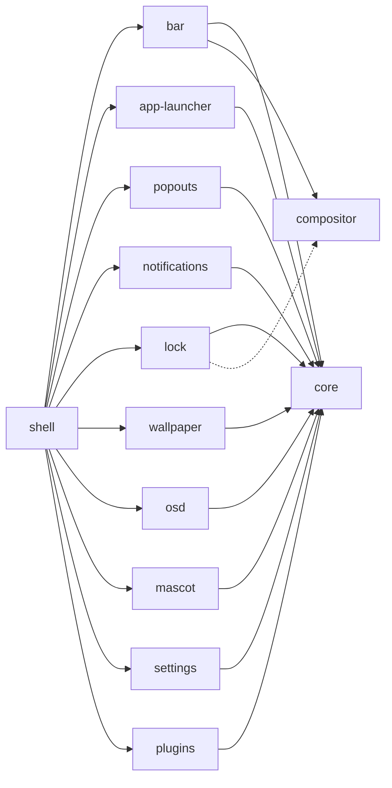

<h1 align="center">twilight-shell</h1>

<p align="center">
Un desktop per Wayland fatto di pezzi che vivono ciascuno nel proprio repository e si installano separatamente.<br> Costruito con <a href="https://quickshell.org">Quickshell</a>, dipinto come un cielo notturno sopra Ponyville.
</p>

<p align="center">
  <a href="https://github.com/twilight-shell/shell/actions/workflows/ci.yml"></a>
  <a href="https://github.com/twilight-shell/shell/releases"></a>
  <a href="../../LICENSE"></a>
</p>

<!-- lang:start -->
<p align="center">
  <a href="../../README.md">English</a> ·
  <a href="README.ru.md">Русский</a> ·
  <a href="README.uk.md">Українська</a> ·
  <a href="README.de.md">Deutsch</a> ·
  <a href="README.fr.md">Français</a> ·
  <a href="README.es.md">Español</a> ·
  <a href="README.pt-BR.md">Português</a> ·
  <b>Italiano</b> ·
  <a href="README.zh-CN.md">简体中文</a> ·
  <a href="README.ja.md">日本語</a> ·
  <a href="README.ko.md">한국어</a>
</p>
<!-- lang:end -->

<p align="center">
  
</p>

## Indice

<!-- toc:start -->
- [Che cos'è](#che-cosè)
- [Anteprima](#anteprima)
- [Schermate](#schermate)
  - [La barra](#la-barra)
  - [Il launcher](#il-launcher)
  - [Schede a comparsa](#schede-a-comparsa)
  - [Notifiche e indicatore del volume](#notifiche-e-indicatore-del-volume)
  - [La schermata di blocco](#la-schermata-di-blocco)
  - [La mascotte](#la-mascotte)
  - [Lo sfondo e le palette](#lo-sfondo-e-le-palette)
  - [La finestra delle impostazioni](#la-finestra-delle-impostazioni)
  - [Plugin](#plugin)
- [Requisiti](#requisiti)
- [Installazione](#installazione)
- [Avvio](#avvio)
- [Uso](#uso)
- [Impostazioni](#impostazioni)
- [Componenti](#componenti)
- [Plugin](#plugin-1)
- [Risoluzione dei problemi](#risoluzione-dei-problemi)
- [Aggiornamento](#aggiornamento)
- [Contribuire](#contribuire)
- [Crediti](#crediti)
- [Licenza](#licenza)
<!-- toc:end -->

## Che cos'è

Una barra, un launcher, le notifiche, una schermata di blocco, uno sfondo, una mascotte, una finestra delle impostazioni e dei plugin, tutto disegnato nello stesso stile ad adesivi che segue un'unica palette.

- **Pezzi, non un blocco.** Ogni componente è un repository a sé che funziona da solo e si installa da solo. Vuoi solo il launcher? Installa solo il launcher. Non ti piace la barra? Lasciala fuori. Questo repository si limita a metterli insieme.
- **Le impostazioni sono semplici file TOML** in `~/.config/twilight-shell/`, creati dai valori predefiniti la prima volta che un componente viene eseguito e applicati nel momento in cui li salvi. Oppure usa la finestra delle impostazioni.
- **Estensibile.** Un plugin è una cartella con un `plugin.toml` e un po' di QML. Può disegnare finestre, rispondere a chiamate IPC, mettere un'isola nella barra e ottenere una pagina nella finestra delle impostazioni.
- **Non legato a un solo compositor.** Oggi gira su [niri](https://github.com/YaLTeR/niri). Tutto ciò che parla con il compositor passa da un piccolo modulo, così altri possono seguire.

## Anteprima

<p align="center">
  <a href="../../docs/media/preview.mp4"></a>
</p>

Un breve giro: il launcher, il calendario e il mixer audio, le notifiche, l'indicatore del volume, la finestra delle impostazioni e la schermata di blocco. Clicca sull'immagine per riprodurlo.

## Schermate

### La barra

Isole fluttuanti lungo il bordo superiore di ogni schermo: il pulsante del launcher, gli spazi di lavoro, la finestra attiva, un orologio (24 ore o AM/PM, con o senza secondi), la disposizione della tastiera, la tray e il volume. I plugin possono aggiungere isole proprie.


### Il launcher

«Twilight's Library»: una carta da libro di incantesimi su un cielo notturno. Scrivi per cercare, e trova Firefox anche se l'hai digitato con la disposizione di tastiera sbagliata.


### Schede a comparsa

Schede che scendono dalla barra: un calendario con la fase della luna sotto l'orologio e un mixer audio sotto il volume con ogni uscita, ingresso e app.

 

### Notifiche e indicatore del volume

Il demone delle notifiche: azioni, urgenza, una miccia che si consuma finché una scheda è visibile, e schede che fanno posto a quelle a comparsa. E l'indicatore che sale dal bordo inferiore quando il volume cambia.


 

### La schermata di blocco

Un processo a sé che esiste solo finché la sessione è bloccata: la password passa da PAM, viene mostrata la disposizione della tastiera per non digitarla in quella sbagliata, e una password errata fa tremare la scheda.


### La mascotte

Twilight vive in un angolo dello schermo. Passeggia lungo il bordo inferiore, parla in un fumetto, balla quando suona musica, si appisola a notte fonda e può essere sollevata e lanciata. I suoi sprite non fanno parte del repository: il repository [mascot](https://github.com/twilight-shell/mascot) ha uno script che li scarica, con i crediti.

 

### Lo sfondo e le palette

Un'immagine svelata da un cerchio che cresce, o un muro di LED di stelle alla deriva e scintillanti nei colori della palette. La palette è una di quelle pronte, una tua, oppure i colori dello sfondo:

  
  
  

### La finestra delle impostazioni

Una pagina per ogni componente che descrive le proprie impostazioni: non c'è nulla da registrare, e un plugin ottiene la sua pagina allo stesso modo. La pagina delle palette permette di crearne una propria con un selettore di colore.

 
 
 

### Plugin

 

## Requisiti

- [Quickshell](https://quickshell.org) 0.3 o successivo (porta con sé Qt 6).
- Un compositor Wayland. Gli spazi di lavoro, la finestra attiva e la disposizione della tastiera finora sono noti per [niri](https://github.com/YaLTeR/niri); la schermata di blocco richiede `ext-session-lock-v1` (niri, Hyprland, Sway e altri lo hanno).
- PipeWire, per il mixer audio, l'indicatore del volume e l'isola del volume.
- PAM, per la schermata di blocco.
- `git` e `make` per installarlo da un clone.
- Facoltativo: il font [Monocraft](https://github.com/IdreesInc/Monocraft) Nerd Font (senza viene usato quello di sistema) e `curl`, per lo script che scarica gli sprite della mascotte.

## Installazione

Tutto, con la shell che lo mette insieme:

```sh
git clone --recurse-submodules git@github.com:twilight-shell/shell.git
cd shell
sudo make install        # the modules to /usr/lib/qt6/qml, twilight-shell to /usr/bin
```

`make install PREFIX=~/.local QMLDIR=~/.local/lib/qt6/qml` mette tutto nella tua cartella personale.

Per installare solo alcuni componenti, indica quali, e ciò di cui hanno bisogno arriva con loro:

```sh
sudo make install ONLY="bar"                 # the bar, with core and compositor
sudo make install ONLY="app-launcher lock"   # two, with core
```

Senza la shell che li mette insieme (niente `twilight-shell`, niente `shell.qml`), ognuno gira da solo: `qs -p /path/to/bar`. Ciò di cui un componente ha bisogno è nel file `DEPENDS` del suo repository, e il suo `make install` lo segnala quando manca qualcosa.

Per provarlo senza installare, eseguilo dal clone: `bin/twilight-shell`.

## Avvio

Avvialo con la tua sessione. In niri:

```kdl
spawn-at-startup "twilight-shell"

binds {
    Mod+P repeat=false { spawn "twilight-shell" "ipc" "call" "launcher" "toggle"; }
    Mod+S repeat=false { spawn "twilight-shell" "ipc" "call" "settings" "toggle"; }
    Mod+Alt+Shift+L repeat=false { spawn "twilight-shell" "lock"; }
}
```

La shell è il demone delle notifiche, e un solo demone può possedere il nome sul bus di sessione: ferma mako, dunst e simili quando passi a lei.

Su NVIDIA, avviala con `__GL_YIELD=USLEEP` nell'ambiente (`spawn-at-startup "env" "__GL_YIELD=USLEEP" "twilight-shell"`): altrimenti il driver attende la GPU in un ciclo attivo e consuma CPU a ogni frame.

Il primo avvio crea un file di impostazioni per ogni componente in `~/.config/twilight-shell/`. Le immagini per lo sfondo vanno in `~/Pictures/Wallpapers`. Per la mascotte, scarica una volta i suoi sprite:

```sh
modules/mascot/scripts/get-sprites.sh        # from the checkout; the folder can be changed in mascot.toml
```

## Uso

`twilight-shell ipc call ...` parla con la shell in esecuzione.

| | |
|---|---|
| `launcher toggle` | Apri e chiudi il launcher. |
| `popout toggle calendar` | Il calendario; `sound` per il mixer. |
| `settings toggle` | La finestra delle impostazioni; `settings open <tab>` apre una scheda. |
| `wallpaper next` | L'immagine successiva; `prev`, `set <path>`, `palette <name>`, `live stars` (o `live ""`). |
| `mascot toggle` | Mandarla fuori vista e farla tornare; `mascot say <text>` la fa parlare. |
| `plugins list` | I plugin e cosa non va in loro; `plugins scan`, `plugins reload`. |

Altri comandi dello script di avvio:

| | |
|---|---|
| `twilight-shell lock` | Blocca la sessione. Un processo a sé che termina quando sblocchi. |
| `twilight-shell lock preview` | Mostra la schermata di blocco senza bloccare nulla. Esc la chiude. |
| `twilight-shell config init` | Crea il file di impostazioni di ogni componente che non ne ha ancora uno. |

## Impostazioni

Un file TOML per componente in `~/.config/twilight-shell/`, applicato non appena viene salvato. Commenti e impaginazione sopravvivono quando la shell riscrive un valore. La finestra e i file modificano la stessa cosa.

| File | Cosa contiene |
|---|---|
| `theme.toml` | `palette` (una pronta, `wallpaper` o una tua), `wallpaper` e le tue `[palettes.<name>]`. |
| `bar.toml` | `window-title` e `[clock]` con `hour24` e `seconds`. |
| `app-launcher.toml` | `terminal`, il comando che esegue le app da terminale. |
| `lock.toml` | `pam`, il servizio PAM con cui viene verificata la password. |
| `wallpaper.toml` | `dir`, `live` e `[stars]` con `dot`, `cell`, `speed` e `glow`. |
| `mascot.toml` | `enabled`, `sprites`, `music`, `sleep`, `chatter`. |
| `plugins.toml` | `dirs`, dove si cercano i plugin, e `enabled`, quelli che girano. |

Una palette tua è una tabella in `theme.toml`:

```toml
palette = "mine"

[palettes.mine]
name = "Mine"
base = "#2a4b3a"        # tints the background and the surfaces
primary = "#9be3b0"     # primary, accent and secondary are used as they are
accent = "#f2b84b"
secondary = "#3f8f7a"
```

Ogni componente descrive le sue chiavi nel suo README.

## Componenti

Ogni componente è un repository a sé, con la propria versione. Questo repository punta ciascuno al commit che è stato provato con gli altri.



| | |
|---|---|
| [core](https://github.com/twilight-shell/core) | Il tema, le palette, il kit di interfaccia ad adesivi, i file di impostazioni. Ogni altro componente ne ha bisogno. |
| [compositor](https://github.com/twilight-shell/compositor) | Spazi di lavoro, finestra attiva e disposizione della tastiera, uguali per ogni compositor (finora niri). |
| [bar](https://github.com/twilight-shell/bar) | La barra. |
| [app-launcher](https://github.com/twilight-shell/app-launcher) | «Twilight's Library», il launcher di applicazioni. |
| [popouts](https://github.com/twilight-shell/popouts) | Il calendario e il mixer audio che scendono dalla barra. |
| [notifications](https://github.com/twilight-shell/notifications) | Il demone delle notifiche e le sue schede. |
| [lock](https://github.com/twilight-shell/lock) | La schermata di blocco. |
| [wallpaper](https://github.com/twilight-shell/wallpaper) | Lo sfondo, un'immagine o stelle vive. |
| [osd](https://github.com/twilight-shell/osd) | L'indicatore del volume. |
| [mascot](https://github.com/twilight-shell/mascot) | Twilight in persona, che passeggia lungo il bordo inferiore. I suoi sprite si scaricano a parte. |
| [settings](https://github.com/twilight-shell/settings) | La finestra delle impostazioni: palette proprie e una pagina per ogni componente che descrive le sue impostazioni. |
| [plugins](https://github.com/twilight-shell/plugins) | Trova i plugin ed esegue quelli attivati. |
| [plugin-template](https://github.com/twilight-shell/plugin-template) | Un plugin da cui partire. |

## Plugin

Un plugin è una cartella con un `plugin.toml` e un po' di QML. Può disegnare finestre, rispondere a chiamate IPC, mettere un'isola nella barra e avere una pagina nella finestra delle impostazioni. Nulla gira finché non lo attivi nella finestra delle impostazioni o in `plugins.toml`. Parti dal [plugin-template](https://github.com/twilight-shell/plugin-template), e leggi come funziona tutto in [plugins](https://github.com/twilight-shell/plugins).

```sh
git clone git@github.com:twilight-shell/plugin-template.git ~/.local/share/twilight-shell/plugins/my-plugin
```

Un plugin è codice che gira con i tuoi permessi, e non c'è sandbox. Attiva solo quelli di cui ti fidi.

## Risoluzione dei problemi

**`module "Twilight.Core" is not installed`.** Il modulo non è in una cartella che Qt cerca. Esegui da un clone con `bin/twilight-shell` (imposta il percorso), installa i moduli (`make install`) oppure punta `QML_IMPORT_PATH` alle cartelle padre dei moduli, come percorsi completi separati da `:`. In fish scrivi `$HOME`: non espande `~` dopo i due punti.

**Niente notifiche, o arrivano da un altro programma.** Un solo demone può possedere `org.freedesktop.Notifications`. Ferma mako, dunst e simili; mako torna da solo tramite l'attivazione D-Bus quando il nome è libero, quindi rimuovi il suo avvio automatico. Chi ha il nome: `busctl --user list | grep Notifications`.

**La CPU è occupata su NVIDIA.** Avvia la shell con `__GL_YIELD=USLEEP` nell'ambiente.

**La mascotte non compare.** Ha bisogno dei suoi sprite: esegui `modules/mascot/scripts/get-sprites.sh` (o quello del repository mascot) e controlla `sprites` in `mascot.toml`.

**Un componente non ha una pagina nella finestra delle impostazioni.** La finestra trova i file `*.schema.toml` dei componenti in `QML_IMPORT_PATH` e nella cartella dove sono installati i moduli. Un componente senza schema non ha pagina.

**Un nuovo componente o plugin non compare.** L'elenco delle cartelle dei moduli viene letto all'avvio della shell: riavviala. Una cartella di plugin aggiunta o rimossa viene notata da sola; `twilight-shell ipc call plugins list` dice cosa vede.

**Lo schermo resta bloccato.** Se il processo di blocco muore, il compositor mantiene la sessione bloccata, ed è proprio lo scopo. Passa a una TTY (Ctrl+Alt+F2), accedi e avvia un blocco per quella sessione, oppure riavvia il compositor.

## Aggiornamento

```sh
git pull --recurse-submodules
sudo make install
qs -p /usr/share/twilight-shell kill && twilight-shell
```

Ogni repository ha la sua versione ([versionamento semantico](https://semver.org), un tag `v0.1.0` per ogni release, un `CHANGELOG.md` che dice cosa contiene). Una release della shell è un insieme di componenti provati insieme: i sottomoduli puntano ai loro commit, e questo mostra quali versioni sono:

```sh
git submodule foreach 'git describe --tags --always'
```

Per rimuoverlo: `sudo make uninstall`.

## Contribuire

Segnalazioni di bug, idee, documentazione e plugin sono tutti benvenuti. Leggi [CONTRIBUTING.md](../../CONTRIBUTING.md) e, se sei un agente, [AGENTS.md](../../AGENTS.md). Seguiamo il [Codice di condotta](https://github.com/twilight-shell/.github/blob/main/CODE_OF_CONDUCT.md); i problemi di sicurezza si segnalano in privato, vedi [SECURITY.md](https://github.com/twilight-shell/.github/blob/main/SECURITY.md).

## Crediti

Gli sprite della mascotte non fanno parte di questo progetto: lo script `get-sprites.sh` del repository mascot scarica quelli di Twilight Sparkle da [Desktop Ponies](https://github.com/RoosterDragon/Desktop-Ponies), opera di RoosterDragon e dei molti artisti che li hanno disegnati e condivisi con licenza CC BY-NC-SA 3.0 ([crediti](https://github.com/RoosterDragon/Desktop-Ponies/blob/master/Content/credits.txt)). Grazie. My Little Pony: Friendship is Magic è © Hasbro; questo progetto non è affiliato a Hasbro né a Desktop Ponies, né da loro approvato. Il font è [Monocraft](https://github.com/IdreesInc/Monocraft), con i simboli Nerd Font.

## Licenza

MIT, vedi [LICENSE](../../LICENSE). Gli sprite mantengono la propria licenza, CC BY-NC-SA 3.0.
