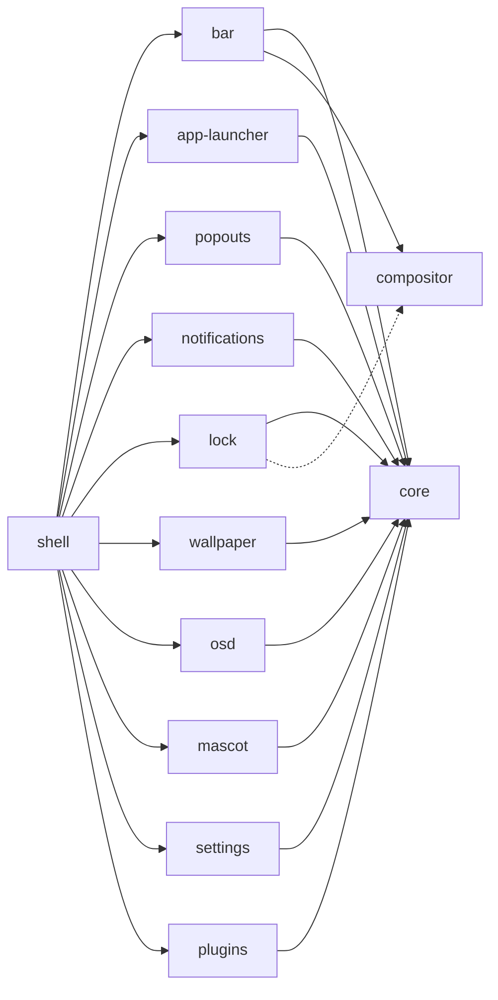

<h1 align="center">twilight-shell</h1>

<p align="center">
Wayland 向けのデスクトップシェル。それぞれが独自のリポジトリに住み、単独でインストールできる部品から作られています。<br> <a href="https://quickshell.org">Quickshell</a> で作られ、ポニービルの夜空のように描かれています。
</p>

<p align="center">
  <a href="https://github.com/twilight-shell/shell/actions/workflows/ci.yml"></a>
  <a href="https://github.com/twilight-shell/shell/releases"></a>
  <a href="../../LICENSE"></a>
</p>

<!-- lang:start -->
<p align="center">
  <a href="../../README.md">English</a> ·
  <a href="README.ru.md">Русский</a> ·
  <a href="README.uk.md">Українська</a> ·
  <a href="README.de.md">Deutsch</a> ·
  <a href="README.fr.md">Français</a> ·
  <a href="README.es.md">Español</a> ·
  <a href="README.pt-BR.md">Português</a> ·
  <a href="README.it.md">Italiano</a> ·
  <a href="README.zh-CN.md">简体中文</a> ·
  <b>日本語</b> ·
  <a href="README.ko.md">한국어</a>
</p>
<!-- lang:end -->

<p align="center">
  
</p>

## 目次

<!-- toc:start -->
- [これは何か](#これは何か)
- [プレビュー](#プレビュー)
- [スクリーンショット](#スクリーンショット)
  - [バー](#バー)
  - [ランチャー](#ランチャー)
  - [ポップアウト](#ポップアウト)
  - [通知と音量表示](#通知と音量表示)
  - [ロック画面](#ロック画面)
  - [マスコット](#マスコット)
  - [壁紙とパレット](#壁紙とパレット)
  - [設定ウィンドウ](#設定ウィンドウ)
  - [プラグイン](#プラグイン)
- [必要なもの](#必要なもの)
- [インストール](#インストール)
- [起動](#起動)
- [使い方](#使い方)
- [設定](#設定)
- [コンポーネント](#コンポーネント)
- [プラグイン](#プラグイン-1)
- [トラブルシューティング](#トラブルシューティング)
- [アップデート](#アップデート)
- [コントリビュート](#コントリビュート)
- [クレジット](#クレジット)
- [ライセンス](#ライセンス)
<!-- toc:end -->

## これは何か

バー、ランチャー、通知、ロック画面、壁紙、マスコット、設定ウィンドウ、プラグイン。すべてが、ひとつのパレットに従う同じステッカー調のスタイルで描かれています。

- **ひとかたまりではなく、部品です。** 各コンポーネントは独立したリポジトリで、単独で動き、単独でインストールできます。ランチャーだけ欲しい？ ランチャーだけ入れてください。バーが好きじゃない？ 外してください。このリポジトリは、それらを組み合わせるだけです。
- **設定は普通の TOML ファイル**で、`~/.config/twilight-shell/` に置かれます。コンポーネントの初回起動時にデフォルト値から作られ、保存した瞬間に反映されます。設定ウィンドウでも変更できます。
- **拡張できます。** プラグインは `plugin.toml` と少しの QML を入れたフォルダです。ウィンドウを描いたり、IPC 呼び出しに応答したり、バーに島を置いたり、設定ウィンドウにページを持ったりできます。
- **特定のコンポジタに縛られません。** 現在は [niri](https://github.com/YaLTeR/niri) で動きます。コンポジタとやり取りする部分はすべて小さなモジュールを通るので、他のコンポジタにも対応できます。

## プレビュー

<p align="center">
  <a href="../../docs/media/preview.mp4"></a>
</p>

短いツアー：ランチャー、カレンダーとサウンドミキサー、通知、音量表示、設定ウィンドウ、ロック画面。画像をクリックすると動画を再生します。

## スクリーンショット

### バー

各画面の上端に沿って浮かぶ島：ランチャーボタン、ワークスペース、フォーカス中のウィンドウ、時計（24 時間または AM/PM、秒の有無）、キーボードレイアウト、トレイ、音量。プラグインは独自の島を追加できます。


### ランチャー

"Twilight's Library"：夜空の上に広がる魔法書のカード。入力して検索でき、キーボードレイアウトを間違えて Firefox と打っても見つけてくれます。


### ポップアウト

バーから降りてくるカード：時計の下には月の満ち欠けつきのカレンダー、音量の下にはすべての出力、入力、アプリが並ぶサウンドミキサー。

 

### 通知と音量表示

通知デーモン：アクション、緊急度、カードの表示中に燃え尽きていく導火線、ポップアウトに場所を譲るカード。そして、音量が変わると下端から上がってくる表示。


 

### ロック画面

セッションがロックされている間だけ存在する独立したプロセス：パスワードは PAM で検証され、間違ったレイアウトで入力しないようキーボードレイアウトが表示され、パスワードが違うとカードが揺れます。


### マスコット

Twilight は画面の隅に住んでいます。下端を散歩し、吹き出しで話し、音楽が流れると踊り、夜遅くにはうたた寝し、持ち上げて投げることもできます。スプライトはリポジトリに含まれていません。[mascot](https://github.com/twilight-shell/mascot) リポジトリに、クレジットつきでダウンロードするスクリプトがあります。

 

### 壁紙とパレット

広がる円で現れる画像、またはパレットの色で漂い瞬く星の LED ウォール。パレットは用意されたもの、自分で作ったもの、壁紙の色のいずれかです：

  
  
  

### 設定ウィンドウ

設定を記述するコンポーネントごとにページがあります。登録は不要で、プラグインも同じ方法でページを得ます。パレットのページでは、カラーピッカーで自分のパレットを作れます。

 
 
 

### プラグイン

 

## 必要なもの

- [Quickshell](https://quickshell.org) 0.3 以降（Qt 6 が付属します）。
- Wayland コンポジタ。ワークスペース、フォーカス中のウィンドウ、キーボードレイアウトは今のところ [niri](https://github.com/YaLTeR/niri) 向けです。ロック画面には `ext-session-lock-v1` が必要です（niri、Hyprland、Sway などにあります）。
- PipeWire：サウンドミキサー、音量表示、音量の島のため。
- PAM：ロック画面のため。
- `git` と `make`：チェックアウトからインストールするため。
- 任意：[Monocraft](https://github.com/IdreesInc/Monocraft) Nerd Font（なければシステムフォントを使います）と、マスコットのスプライトを取得するスクリプトのための `curl`。

## インストール

すべてを、組み合わせるシェルと一緒に：

```sh
git clone --recurse-submodules git@github.com:twilight-shell/shell.git
cd shell
sudo make install        # the modules to /usr/lib/qt6/qml, twilight-shell to /usr/bin
```

`make install PREFIX=~/.local QMLDIR=~/.local/lib/qt6/qml` なら、代わりにすべてをホームディレクトリに入れます。

一部のコンポーネントだけをインストールするには、どれかを指定すれば、必要なものも一緒に入ります：

```sh
sudo make install ONLY="bar"                 # the bar, with core and compositor
sudo make install ONLY="app-launcher lock"   # two, with core
```

組み合わせるシェル（`twilight-shell` と `shell.qml`）がなくても、それぞれ単独で動きます：`qs -p /path/to/bar`。コンポーネントが必要とするものはそのリポジトリの `DEPENDS` ファイルにあり、足りないものがあれば `make install` が知らせます。

インストールせずに試すには、チェックアウトから実行します：`bin/twilight-shell`。

## 起動

セッションと一緒に起動します。niri では：

```kdl
spawn-at-startup "twilight-shell"

binds {
    Mod+P repeat=false { spawn "twilight-shell" "ipc" "call" "launcher" "toggle"; }
    Mod+S repeat=false { spawn "twilight-shell" "ipc" "call" "settings" "toggle"; }
    Mod+Alt+Shift+L repeat=false { spawn "twilight-shell" "lock"; }
}
```

このシェルは通知デーモンでもあり、セッションバス上の名前を持てるデーモンは一つだけです。切り替えるときは mako や dunst などを止めてください。

NVIDIA では、環境に `__GL_YIELD=USLEEP` を設定して起動してください（`spawn-at-startup "env" "__GL_YIELD=USLEEP" "twilight-shell"`）。そうしないとドライバが GPU を待ってビジーウェイトし、毎フレーム CPU を消費します。

初回起動時に、各コンポーネントの設定ファイルが `~/.config/twilight-shell/` に作られます。壁紙用の画像は `~/Pictures/Wallpapers` に置きます。マスコットのスプライトは一度だけ取得してください：

```sh
modules/mascot/scripts/get-sprites.sh        # from the checkout; the folder can be changed in mascot.toml
```

## 使い方

`twilight-shell ipc call ...` は、動作中のシェルに話しかけます。

| | |
|---|---|
| `launcher toggle` | ランチャーを開閉します。 |
| `popout toggle calendar` | カレンダー。ミキサーは `sound`。 |
| `settings toggle` | 設定ウィンドウ。`settings open <tab>` でタブを開きます。 |
| `wallpaper next` | 次の画像。ほかに `prev`、`set <path>`、`palette <name>`、`live stars`（または `live ""`）。 |
| `mascot toggle` | 彼女を見えない所へ送って戻します。`mascot say <text>` で話させます。 |
| `plugins list` | プラグインとその問題点。`plugins scan`、`plugins reload`。 |

起動スクリプトのその他のコマンド：

| | |
|---|---|
| `twilight-shell lock` | セッションをロックします。独立したプロセスで、ロック解除で終了します。 |
| `twilight-shell lock preview` | 何もロックせずにロック画面を表示します。Esc で閉じます。 |
| `twilight-shell config init` | まだ設定ファイルのないコンポーネントすべてに設定ファイルを作ります。 |

## 設定

コンポーネントごとに `~/.config/twilight-shell/` に TOML ファイルが一つあり、保存するとすぐに反映されます。シェルが値を書き戻してもコメントとレイアウトは保たれます。ウィンドウとファイルは同じものを編集します。

| ファイル | 中身 |
|---|---|
| `theme.toml` | `palette`（用意されたもの、`wallpaper`、または自作のもの）、`wallpaper`、そして自作の `[palettes.<name>]`。 |
| `bar.toml` | `window-title`、そして `hour24` と `seconds` を持つ `[clock]`。 |
| `app-launcher.toml` | `terminal`、ターミナルアプリを起動するコマンド。 |
| `lock.toml` | `pam`、パスワードの検証に使う PAM サービス。 |
| `wallpaper.toml` | `dir`、`live`、そして `dot`、`cell`、`speed`、`glow` を持つ `[stars]`。 |
| `mascot.toml` | `enabled`、`sprites`、`music`、`sleep`、`chatter`。 |
| `plugins.toml` | `dirs`（プラグインを探す場所）と `enabled`（動かすもの）。 |

自作のパレットは `theme.toml` のテーブルです：

```toml
palette = "mine"

[palettes.mine]
name = "Mine"
base = "#2a4b3a"        # tints the background and the surfaces
primary = "#9be3b0"     # primary, accent and secondary are used as they are
accent = "#f2b84b"
secondary = "#3f8f7a"
```

各コンポーネントのキーは、それぞれの README にあります。

## コンポーネント

各コンポーネントは独自のリポジトリで、独自のバージョンを持ちます。このリポジトリは、それぞれを、他と一緒にテストされたコミットに向けます。



| | |
|---|---|
| [core](https://github.com/twilight-shell/core) | テーマ、パレット、ステッカー調の UI キット、設定ファイル。他のすべてのコンポーネントが必要とします。 |
| [compositor](https://github.com/twilight-shell/compositor) | ワークスペース、フォーカス中のウィンドウ、キーボードレイアウト。どのコンポジタでも同じです（今のところ niri）。 |
| [bar](https://github.com/twilight-shell/bar) | バー。 |
| [app-launcher](https://github.com/twilight-shell/app-launcher) | "Twilight's Library"、アプリランチャー。 |
| [popouts](https://github.com/twilight-shell/popouts) | バーから降りてくるカレンダーとサウンドミキサー。 |
| [notifications](https://github.com/twilight-shell/notifications) | 通知デーモンとそのカード。 |
| [lock](https://github.com/twilight-shell/lock) | ロック画面。 |
| [wallpaper](https://github.com/twilight-shell/wallpaper) | 壁紙。画像またはライブの星。 |
| [osd](https://github.com/twilight-shell/osd) | 音量表示。 |
| [mascot](https://github.com/twilight-shell/mascot) | 下端を散歩する Twilight 本人。スプライトは別にダウンロードします。 |
| [settings](https://github.com/twilight-shell/settings) | 設定ウィンドウ：自作のパレットと、設定を記述するコンポーネントごとのページ。 |
| [plugins](https://github.com/twilight-shell/plugins) | プラグインを見つけ、オンになっているものを実行します。 |
| [plugin-template](https://github.com/twilight-shell/plugin-template) | 出発点にできるプラグイン。 |

## プラグイン

プラグインは `plugin.toml` と少しの QML を入れたフォルダです。ウィンドウを描いたり、IPC 呼び出しに応答したり、バーに島を置いたり、設定ウィンドウにページを持ったりできます。設定ウィンドウか `plugins.toml` でオンにするまで、何も動きません。[plugin-template](https://github.com/twilight-shell/plugin-template) から始め、仕組みは [plugins](https://github.com/twilight-shell/plugins) で読んでください。

```sh
git clone git@github.com:twilight-shell/plugin-template.git ~/.local/share/twilight-shell/plugins/my-plugin
```

プラグインはあなたの権限で動くコードで、サンドボックスはありません。信頼できるものだけをオンにしてください。

## トラブルシューティング

**`module "Twilight.Core" is not installed`。** モジュールが Qt の検索するフォルダにありません。チェックアウトから `bin/twilight-shell` で実行する（パスを設定してくれます）か、モジュールをインストールする（`make install`）か、`QML_IMPORT_PATH` をモジュールの親フォルダに向けてください（フルパスを `:` で区切ります）。fish では `$HOME` と書いてください。コロンの後の `~` は展開されません。

**通知が出ない、または別のプログラムから来る。** `org.freedesktop.Notifications` を持てるデーモンは一つだけです。mako や dunst などを止めてください。名前が空くと mako は D-Bus アクティベーションで自分で戻ってくるので、その自動起動を外してください。誰が名前を持っているか：`busctl --user list | grep Notifications`。

**NVIDIA で CPU が使われる。** 環境に `__GL_YIELD=USLEEP` を設定してシェルを起動してください。

**マスコットが現れない。** スプライトが必要です。`modules/mascot/scripts/get-sprites.sh`（または mascot リポジトリのもの）を実行し、`mascot.toml` の `sprites` を確認してください。

**コンポーネントが設定ウィンドウにページを持たない。** ウィンドウは、`QML_IMPORT_PATH` とモジュールがインストールされたフォルダから、コンポーネントの `*.schema.toml` を探します。スキーマのないコンポーネントにはページがありません。

**新しいコンポーネントやプラグインが現れない。** モジュールフォルダの一覧はシェルの起動時に読まれます。再起動してください。追加または削除されたプラグインフォルダは自動で検出されます。`twilight-shell ipc call plugins list` で見えているものを確認できます。

**画面がロックされたままになる。** ロックのプロセスが終了すると、コンポジタはセッションをロックしたままにします。それが狙いです。TTY（Ctrl+Alt+F2）に切り替えてログインし、そのセッション用のロッカーを起動するか、コンポジタを再起動してください。

## アップデート

```sh
git pull --recurse-submodules
sudo make install
qs -p /usr/share/twilight-shell kill && twilight-shell
```

各リポジトリは独自にバージョン管理されています（[セマンティックバージョニング](https://semver.org)、リリースごとにタグ `v0.1.0`、内容を記した `CHANGELOG.md`）。シェルのリリースは、一緒にテストされたコンポーネントの組です。サブモジュールがそれぞれのコミットを指し、次のコマンドでバージョンがわかります：

```sh
git submodule foreach 'git describe --tags --always'
```

削除するには：`sudo make uninstall`。

## コントリビュート

バグ報告、アイデア、ドキュメント、プラグインはどれも歓迎です。[CONTRIBUTING.md](../../CONTRIBUTING.md) をお読みください。エージェントの方は [AGENTS.md](../../AGENTS.md) もどうぞ。私たちは[行動規範](https://github.com/twilight-shell/.github/blob/main/CODE_OF_CONDUCT.md)に従います。セキュリティ上の問題は非公開で報告してください。[SECURITY.md](https://github.com/twilight-shell/.github/blob/main/SECURITY.md) を参照してください。

## クレジット

マスコットのスプライトはこのプロジェクトの一部ではありません。mascot リポジトリの `get-sprites.sh` スクリプトが、[Desktop Ponies](https://github.com/RoosterDragon/Desktop-Ponies) から Twilight Sparkle のものをダウンロードします。これは RoosterDragon と、描いて CC BY-NC-SA 3.0 で共有した多くのアーティストの作品です（[クレジット](https://github.com/RoosterDragon/Desktop-Ponies/blob/master/Content/credits.txt)）。ありがとうございます。My Little Pony: Friendship is Magic は © Hasbro です。このプロジェクトは Hasbro や Desktop Ponies と提携しておらず、承認も受けていません。フォントは [Monocraft](https://github.com/IdreesInc/Monocraft) で、Nerd Font のシンボルが追加されています。

## ライセンス

MIT。[LICENSE](../../LICENSE) を参照してください。スプライトは独自のライセンス CC BY-NC-SA 3.0 を保ちます。
