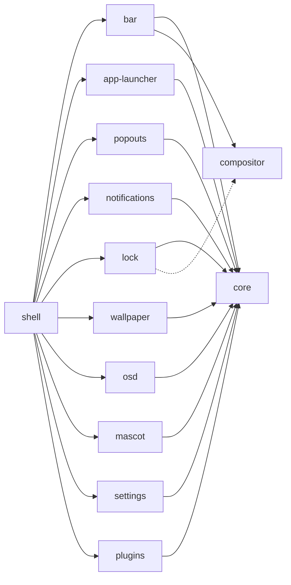

<h1 align="center">twilight-shell</h1>

<p align="center">
Wayland용 데스크톱 셸로, 각자 자기 저장소에 살면서 따로 설치되는 조각들로 만들어졌습니다.<br> <a href="https://quickshell.org">Quickshell</a>로 만들었고, 포니빌 위의 밤하늘처럼 그렸습니다.
</p>

<p align="center">
  <a href="https://github.com/twilight-shell/shell/actions/workflows/ci.yml"></a>
  <a href="https://github.com/twilight-shell/shell/releases"></a>
  <a href="../../LICENSE"></a>
</p>

<!-- lang:start -->
<p align="center">
  <a href="../../README.md">English</a> ·
  <a href="README.ru.md">Русский</a> ·
  <a href="README.uk.md">Українська</a> ·
  <a href="README.de.md">Deutsch</a> ·
  <a href="README.fr.md">Français</a> ·
  <a href="README.es.md">Español</a> ·
  <a href="README.pt-BR.md">Português</a> ·
  <a href="README.it.md">Italiano</a> ·
  <a href="README.zh-CN.md">简体中文</a> ·
  <a href="README.ja.md">日本語</a> ·
  <b>한국어</b>
</p>
<!-- lang:end -->

<p align="center">
  
</p>

## 목차

<!-- toc:start -->
- [이것은 무엇인가](#이것은-무엇인가)
- [미리보기](#미리보기)
- [스크린샷](#스크린샷)
  - [바](#바)
  - [런처](#런처)
  - [팝아웃](#팝아웃)
  - [알림과 볼륨 표시](#알림과-볼륨-표시)
  - [잠금 화면](#잠금-화면)
  - [마스코트](#마스코트)
  - [배경화면과 팔레트](#배경화면과-팔레트)
  - [설정 창](#설정-창)
  - [플러그인](#플러그인)
- [요구 사항](#요구-사항)
- [설치](#설치)
- [실행](#실행)
- [사용법](#사용법)
- [설정](#설정)
- [컴포넌트](#컴포넌트)
- [플러그인](#플러그인-1)
- [문제 해결](#문제-해결)
- [업데이트](#업데이트)
- [기여하기](#기여하기)
- [크레딧](#크레딧)
- [라이선스](#라이선스)
<!-- toc:end -->

## 이것은 무엇인가

바, 런처, 알림, 잠금 화면, 배경화면, 마스코트, 설정 창, 플러그인이 모두 하나의 팔레트를 따르는 같은 스티커 스타일로 그려져 있습니다.

- **한 덩어리가 아니라 조각들입니다.** 각 컴포넌트는 독립된 저장소이고, 혼자서 동작하며 혼자서 설치됩니다. 런처만 필요한가요? 런처만 설치하세요. 바가 마음에 들지 않나요? 빼세요. 이 저장소는 그것들을 한데 모을 뿐입니다.
- **설정은 평범한 TOML 파일**이며 `~/.config/twilight-shell/`에 있습니다. 컴포넌트를 처음 실행할 때 기본값으로 만들어지고, 저장하는 순간 적용됩니다. 설정 창을 써도 됩니다.
- **확장할 수 있습니다.** 플러그인은 `plugin.toml`과 약간의 QML이 든 폴더입니다. 창을 그리고, IPC 호출에 응답하고, 바에 섬을 놓고, 설정 창에 페이지를 가질 수 있습니다.
- **특정 컴포지터에 묶여 있지 않습니다.** 지금은 [niri](https://github.com/YaLTeR/niri)에서 동작합니다. 컴포지터와 대화하는 모든 것은 작은 모듈 하나를 거치므로, 다른 컴포지터도 뒤따를 수 있습니다.

## 미리보기

<p align="center">
  <a href="../../docs/media/preview.mp4"></a>
</p>

짧은 투어: 런처, 캘린더와 사운드 믹서, 알림, 볼륨 표시, 설정 창, 잠금 화면. 그림을 클릭하면 재생됩니다.

## 스크린샷

### 바

각 화면 상단을 따라 떠 있는 섬들: 런처 버튼, 작업 공간, 포커스된 창, 시계(24시간제 또는 AM/PM, 초 표시 여부 선택), 키보드 레이아웃, 트레이, 볼륨. 플러그인은 자신의 섬을 추가할 수 있습니다.


### 런처

"Twilight's Library": 밤하늘 위의 마법서 카드. 입력해서 검색하며, 키보드 레이아웃을 잘못 두고 Firefox를 쳐도 찾아 줍니다.


### 팝아웃

바에서 내려오는 카드: 시계 아래에는 달의 위상이 있는 캘린더, 볼륨 아래에는 모든 출력, 입력, 앱이 있는 사운드 믹서.

 

### 알림과 볼륨 표시

알림 데몬: 동작, 긴급도, 카드가 표시되는 동안 타들어 가는 심지, 팝아웃에게 자리를 내주는 카드. 그리고 볼륨이 바뀌면 아래쪽 가장자리에서 올라오는 표시.


 

### 잠금 화면

세션이 잠겨 있는 동안에만 존재하는 독립 프로세스: 비밀번호는 PAM으로 확인되고, 잘못된 레이아웃으로 입력하지 않도록 키보드 레이아웃이 표시되며, 비밀번호가 틀리면 카드가 흔들립니다.


### 마스코트

Twilight는 화면 한구석에 삽니다. 아래쪽 가장자리를 따라 산책하고, 말풍선으로 말하고, 음악이 나오면 춤추고, 밤늦게는 졸고, 집어 들어 던질 수도 있습니다. 스프라이트는 저장소에 포함되어 있지 않습니다. [mascot](https://github.com/twilight-shell/mascot) 저장소에 출처와 함께 내려받는 스크립트가 있습니다.

 

### 배경화면과 팔레트

커지는 원으로 드러나는 그림, 또는 팔레트 색으로 떠다니며 반짝이는 별들의 LED 벽. 팔레트는 준비된 것, 직접 만든 것, 또는 배경화면의 색 중 하나입니다:

  
  
  

### 설정 창

자신의 설정을 설명하는 컴포넌트마다 페이지가 있습니다. 등록할 것은 없고, 플러그인도 같은 방식으로 페이지를 얻습니다. 팔레트 페이지에서는 색 선택기로 직접 팔레트를 만들 수 있습니다.

 
 
 

### 플러그인

 

## 요구 사항

- [Quickshell](https://quickshell.org) 0.3 이상(Qt 6이 함께 옵니다).
- Wayland 컴포지터. 작업 공간, 포커스된 창, 키보드 레이아웃은 아직 [niri](https://github.com/YaLTeR/niri)용만 알려져 있습니다. 잠금 화면에는 `ext-session-lock-v1`이 필요합니다(niri, Hyprland, Sway 등에 있습니다).
- PipeWire: 사운드 믹서, 볼륨 표시, 볼륨 섬을 위해.
- PAM: 잠금 화면을 위해.
- `git`과 `make`: 체크아웃에서 설치하기 위해.
- 선택: [Monocraft](https://github.com/IdreesInc/Monocraft) Nerd Font(없으면 시스템 글꼴을 씁니다)와, 마스코트의 스프라이트를 내려받는 스크립트를 위한 `curl`.

## 설치

모든 것을, 그것들을 한데 모으는 셸과 함께:

```sh
git clone --recurse-submodules git@github.com:twilight-shell/shell.git
cd shell
sudo make install        # the modules to /usr/lib/qt6/qml, twilight-shell to /usr/bin
```

`make install PREFIX=~/.local QMLDIR=~/.local/lib/qt6/qml`은 대신 모든 것을 홈 디렉터리에 넣습니다.

일부 컴포넌트만 설치하려면 어느 것인지 말해 주세요. 그것들이 필요로 하는 것이 함께 설치됩니다:

```sh
sudo make install ONLY="bar"                 # the bar, with core and compositor
sudo make install ONLY="app-launcher lock"   # two, with core
```

그것들을 모으는 셸(`twilight-shell`과 `shell.qml`) 없이도 각각 혼자 동작합니다: `qs -p /path/to/bar`. 컴포넌트가 필요로 하는 것은 그 저장소의 `DEPENDS` 파일에 있고, 뭔가 빠져 있으면 자체 `make install`이 알려 줍니다.

설치하지 않고 써 보려면 체크아웃에서 실행하세요: `bin/twilight-shell`.

## 실행

세션과 함께 시작하세요. niri에서는:

```kdl
spawn-at-startup "twilight-shell"

binds {
    Mod+P repeat=false { spawn "twilight-shell" "ipc" "call" "launcher" "toggle"; }
    Mod+S repeat=false { spawn "twilight-shell" "ipc" "call" "settings" "toggle"; }
    Mod+Alt+Shift+L repeat=false { spawn "twilight-shell" "lock"; }
}
```

이 셸이 알림 데몬이며, 세션 버스의 이름은 데몬 하나만 가질 수 있습니다. 이것으로 옮겨 올 때 mako, dunst 같은 것을 멈추세요.

NVIDIA에서는 환경에 `__GL_YIELD=USLEEP`를 설정해 시작하세요(`spawn-at-startup "env" "__GL_YIELD=USLEEP" "twilight-shell"`). 그렇지 않으면 드라이버가 GPU를 바쁘게 기다리며 매 프레임 CPU를 소모합니다.

처음 시작하면 각 컴포넌트의 설정 파일이 `~/.config/twilight-shell/`에 만들어집니다. 배경화면 그림은 `~/Pictures/Wallpapers`에 넣습니다. 마스코트는 스프라이트를 한 번 내려받으세요:

```sh
modules/mascot/scripts/get-sprites.sh        # from the checkout; the folder can be changed in mascot.toml
```

## 사용법

`twilight-shell ipc call ...`은 실행 중인 셸과 대화합니다.

| | |
|---|---|
| `launcher toggle` | 런처를 열고 닫습니다. |
| `popout toggle calendar` | 캘린더. 믹서는 `sound`. |
| `settings toggle` | 설정 창. `settings open <tab>`은 탭을 엽니다. |
| `wallpaper next` | 다음 그림. 그 밖에 `prev`, `set <path>`, `palette <name>`, `live stars`(또는 `live ""`). |
| `mascot toggle` | 그녀를 시야 밖으로 보냈다가 돌려놓습니다. `mascot say <text>`는 그녀가 말하게 합니다. |
| `plugins list` | 플러그인과 그것들의 문제. `plugins scan`, `plugins reload`. |

시작 스크립트의 다른 명령:

| | |
|---|---|
| `twilight-shell lock` | 세션을 잠급니다. 잠금을 풀면 끝나는 독립 프로세스입니다. |
| `twilight-shell lock preview` | 아무것도 잠그지 않고 잠금 화면을 보여 줍니다. Esc로 닫습니다. |
| `twilight-shell config init` | 아직 설정 파일이 없는 모든 컴포넌트의 설정 파일을 만듭니다. |

## 설정

컴포넌트마다 `~/.config/twilight-shell/`에 TOML 파일이 하나씩 있으며, 저장하는 즉시 적용됩니다. 셸이 값을 다시 쓸 때도 주석과 레이아웃은 유지됩니다. 창과 파일은 같은 것을 편집합니다.

| 파일 | 내용 |
|---|---|
| `theme.toml` | `palette`(준비된 것, `wallpaper`, 또는 직접 만든 것), `wallpaper`, 그리고 직접 만든 `[palettes.<name>]`. |
| `bar.toml` | `window-title`, 그리고 `hour24`와 `seconds`가 있는 `[clock]`. |
| `app-launcher.toml` | `terminal`, 터미널 앱을 실행하는 명령. |
| `lock.toml` | `pam`, 비밀번호를 확인하는 PAM 서비스. |
| `wallpaper.toml` | `dir`, `live`, 그리고 `dot`, `cell`, `speed`, `glow`가 있는 `[stars]`. |
| `mascot.toml` | `enabled`, `sprites`, `music`, `sleep`, `chatter`. |
| `plugins.toml` | `dirs`(플러그인을 찾는 곳)와 `enabled`(실행되는 것). |

직접 만든 팔레트는 `theme.toml`의 테이블입니다:

```toml
palette = "mine"

[palettes.mine]
name = "Mine"
base = "#2a4b3a"        # tints the background and the surfaces
primary = "#9be3b0"     # primary, accent and secondary are used as they are
accent = "#f2b84b"
secondary = "#3f8f7a"
```

각 컴포넌트의 키는 그 README에 있습니다.

## 컴포넌트

각 컴포넌트는 자기 저장소이며 자기 버전을 가집니다. 이 저장소는 각각을, 나머지와 함께 테스트된 커밋으로 가리킵니다.



| | |
|---|---|
| [core](https://github.com/twilight-shell/core) | 테마, 팔레트, 스티커 UI 키트, 설정 파일. 다른 모든 컴포넌트가 필요로 합니다. |
| [compositor](https://github.com/twilight-shell/compositor) | 작업 공간, 포커스된 창, 키보드 레이아웃. 어떤 컴포지터에서나 같습니다(지금은 niri). |
| [bar](https://github.com/twilight-shell/bar) | 바. |
| [app-launcher](https://github.com/twilight-shell/app-launcher) | "Twilight's Library", 앱 런처. |
| [popouts](https://github.com/twilight-shell/popouts) | 바에서 내려오는 캘린더와 사운드 믹서. |
| [notifications](https://github.com/twilight-shell/notifications) | 알림 데몬과 그 카드들. |
| [lock](https://github.com/twilight-shell/lock) | 잠금 화면. |
| [wallpaper](https://github.com/twilight-shell/wallpaper) | 배경화면, 그림 또는 살아 있는 별. |
| [osd](https://github.com/twilight-shell/osd) | 볼륨 표시. |
| [mascot](https://github.com/twilight-shell/mascot) | 아래쪽 가장자리를 산책하는 Twilight 본인. 스프라이트는 따로 내려받습니다. |
| [settings](https://github.com/twilight-shell/settings) | 설정 창: 직접 만든 팔레트와, 설정을 설명하는 컴포넌트마다의 페이지. |
| [plugins](https://github.com/twilight-shell/plugins) | 플러그인을 찾아 켜져 있는 것을 실행합니다. |
| [plugin-template](https://github.com/twilight-shell/plugin-template) | 시작점으로 쓸 플러그인. |

## 플러그인

플러그인은 `plugin.toml`과 약간의 QML이 든 폴더입니다. 창을 그리고, IPC 호출에 응답하고, 바에 섬을 놓고, 설정 창에 페이지를 가질 수 있습니다. 설정 창이나 `plugins.toml`에서 켜기 전에는 아무것도 실행되지 않습니다. [plugin-template](https://github.com/twilight-shell/plugin-template)에서 시작하고, 전체가 어떻게 동작하는지는 [plugins](https://github.com/twilight-shell/plugins)에서 읽으세요.

```sh
git clone git@github.com:twilight-shell/plugin-template.git ~/.local/share/twilight-shell/plugins/my-plugin
```

플러그인은 당신의 권한으로 실행되는 코드이며 샌드박스가 없습니다. 신뢰하는 것만 켜세요.

## 문제 해결

**`module "Twilight.Core" is not installed`.** 모듈이 Qt가 찾는 폴더에 없습니다. 체크아웃에서 `bin/twilight-shell`로 실행하거나(경로를 설정해 줍니다), 모듈을 설치하거나(`make install`), `QML_IMPORT_PATH`를 모듈의 상위 폴더로 지정하세요(전체 경로를 `:`로 구분). fish에서는 `$HOME`이라고 쓰세요. 콜론 뒤의 `~`는 확장되지 않습니다.

**알림이 없거나 다른 프로그램에서 옵니다.** `org.freedesktop.Notifications`는 데몬 하나만 가질 수 있습니다. mako, dunst 같은 것을 멈추세요. 이름이 비면 mako는 D-Bus 활성화로 스스로 돌아오므로 그 자동 시작을 제거하세요. 이름을 누가 가졌는지: `busctl --user list | grep Notifications`.

**NVIDIA에서 CPU가 바쁩니다.** 환경에 `__GL_YIELD=USLEEP`를 설정하고 셸을 시작하세요.

**마스코트가 나타나지 않습니다.** 스프라이트가 필요합니다. `modules/mascot/scripts/get-sprites.sh`(또는 mascot 저장소의 것)를 실행하고 `mascot.toml`의 `sprites`를 확인하세요.

**컴포넌트가 설정 창에 페이지가 없습니다.** 창은 `QML_IMPORT_PATH`와 모듈이 설치된 폴더에서 컴포넌트의 `*.schema.toml` 파일을 찾습니다. 스키마가 없는 컴포넌트에는 페이지가 없습니다.

**새 컴포넌트나 플러그인이 나타나지 않습니다.** 모듈 폴더 목록은 셸이 시작할 때 읽습니다. 다시 시작하세요. 추가되거나 제거된 플러그인 폴더는 스스로 감지됩니다. `twilight-shell ipc call plugins list`로 무엇이 보이는지 확인할 수 있습니다.

**화면이 계속 잠겨 있습니다.** 잠금 프로세스가 죽으면 컴포지터는 세션을 잠근 채로 둡니다. 그것이 목적입니다. TTY(Ctrl+Alt+F2)로 전환해 로그인한 뒤 그 세션용 잠금 프로그램을 시작하거나 컴포지터를 다시 시작하세요.

## 업데이트

```sh
git pull --recurse-submodules
sudo make install
qs -p /usr/share/twilight-shell kill && twilight-shell
```

각 저장소는 자체적으로 버전이 관리됩니다([유의적 버전](https://semver.org), 릴리스마다 태그 `v0.1.0`, 무엇이 들어 있는지 알려 주는 `CHANGELOG.md`). 셸의 릴리스는 함께 테스트된 컴포넌트의 묶음입니다. 서브모듈이 각자의 커밋을 가리키며, 다음 명령이 어떤 버전인지 보여 줍니다:

```sh
git submodule foreach 'git describe --tags --always'
```

제거하려면: `sudo make uninstall`.

## 기여하기

버그 보고, 아이디어, 문서, 플러그인 모두 환영합니다. [CONTRIBUTING.md](../../CONTRIBUTING.md)를 읽어 주세요. 에이전트라면 [AGENTS.md](../../AGENTS.md)도 읽으세요. 우리는 [행동 강령](https://github.com/twilight-shell/.github/blob/main/CODE_OF_CONDUCT.md)을 따릅니다. 보안 문제는 비공개로 보고해 주세요. [SECURITY.md](https://github.com/twilight-shell/.github/blob/main/SECURITY.md)를 참고하세요.

## 크레딧

마스코트의 스프라이트는 이 프로젝트의 일부가 아닙니다. mascot 저장소의 `get-sprites.sh` 스크립트가 [Desktop Ponies](https://github.com/RoosterDragon/Desktop-Ponies)에서 Twilight Sparkle의 것을 내려받습니다. 이것은 RoosterDragon과, 그리고 CC BY-NC-SA 3.0으로 공유한 많은 아티스트의 작업입니다([크레딧](https://github.com/RoosterDragon/Desktop-Ponies/blob/master/Content/credits.txt)). 감사합니다. My Little Pony: Friendship is Magic은 © Hasbro입니다. 이 프로젝트는 Hasbro나 Desktop Ponies와 제휴하지 않았고 그들의 보증을 받지 않았습니다. 글꼴은 [Monocraft](https://github.com/IdreesInc/Monocraft)이며 Nerd Font 기호가 추가되었습니다.

## 라이선스

MIT, [LICENSE](../../LICENSE)를 보세요. 스프라이트는 자체 라이선스 CC BY-NC-SA 3.0을 유지합니다.
