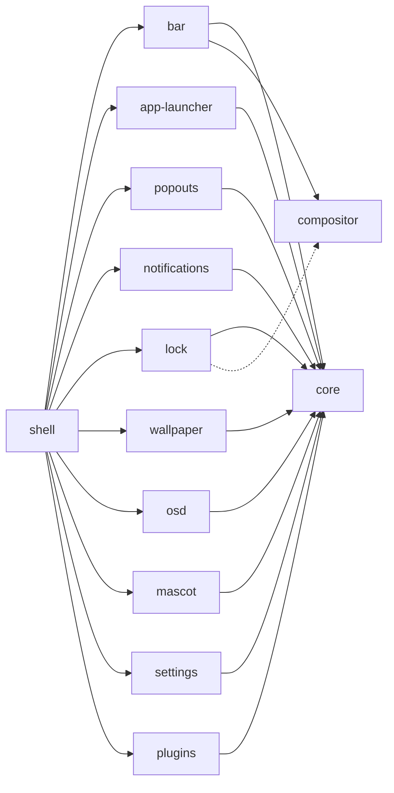

<h1 align="center">twilight-shell</h1>

<p align="center">
Um desktop para Wayland feito de peças que vivem cada uma em seu próprio repositório e se instalam separadamente.<br> Construído com o <a href="https://quickshell.org">Quickshell</a>, pintado como um céu noturno sobre Ponyville.
</p>

<p align="center">
  <a href="https://github.com/twilight-shell/shell/actions/workflows/ci.yml"></a>
  <a href="https://github.com/twilight-shell/shell/releases"></a>
  <a href="../../LICENSE"></a>
</p>

<!-- lang:start -->
<p align="center">
  <a href="../../README.md">English</a> ·
  <a href="README.ru.md">Русский</a> ·
  <a href="README.uk.md">Українська</a> ·
  <a href="README.de.md">Deutsch</a> ·
  <a href="README.fr.md">Français</a> ·
  <a href="README.es.md">Español</a> ·
  <b>Português</b> ·
  <a href="README.it.md">Italiano</a> ·
  <a href="README.zh-CN.md">简体中文</a> ·
  <a href="README.ja.md">日本語</a> ·
  <a href="README.ko.md">한국어</a>
</p>
<!-- lang:end -->

<p align="center">
  
</p>

## Sumário

<!-- toc:start -->
- [O que é](#o-que-é)
- [Prévia](#prévia)
- [Capturas de tela](#capturas-de-tela)
  - [A barra](#a-barra)
  - [O lançador](#o-lançador)
  - [Cartões suspensos](#cartões-suspensos)
  - [Notificações e o indicador de volume](#notificações-e-o-indicador-de-volume)
  - [A tela de bloqueio](#a-tela-de-bloqueio)
  - [O mascote](#o-mascote)
  - [O papel de parede e as paletas](#o-papel-de-parede-e-as-paletas)
  - [A janela de configurações](#a-janela-de-configurações)
  - [Plugins](#plugins)
- [Requisitos](#requisitos)
- [Instalação](#instalação)
- [Execução](#execução)
- [Uso](#uso)
- [Configurações](#configurações)
- [Componentes](#componentes)
- [Plugins](#plugins-1)
- [Solução de problemas](#solução-de-problemas)
- [Atualização](#atualização)
- [Contribuindo](#contribuindo)
- [Créditos](#créditos)
- [Licença](#licença)
<!-- toc:end -->

## O que é

Uma barra, um lançador, notificações, uma tela de bloqueio, um papel de parede, um mascote, uma janela de configurações e plugins, tudo desenhado no mesmo estilo de adesivos que segue uma única paleta.

- **Peças, não um bloco.** Cada componente é um repositório próprio que funciona sozinho e se instala sozinho. Quer só o lançador? Instale só o lançador. Não gosta da barra? Deixe-a de fora. Este repositório apenas junta tudo.
- **As configurações são arquivos TOML simples** em `~/.config/twilight-shell/`, criados a partir dos valores padrão na primeira vez que um componente roda e aplicados no momento em que você salva. Ou use a janela de configurações.
- **Extensível.** Um plugin é uma pasta com um `plugin.toml` e um pouco de QML. Ele pode desenhar janelas, responder a chamadas IPC, colocar uma ilha na barra e ganhar uma página na janela de configurações.
- **Não preso a um único compositor.** Hoje roda no [niri](https://github.com/YaLTeR/niri). Tudo que fala com o compositor passa por um módulo pequeno, então outros podem seguir.

## Prévia

<p align="center">
  <a href="../../docs/media/preview.mp4"></a>
</p>

Um passeio rápido: o lançador, o calendário e o mixer de som, as notificações, o indicador de volume, a janela de configurações e a tela de bloqueio. Clique na imagem para reproduzir.

## Capturas de tela

### A barra

Ilhas flutuantes ao longo do topo de cada tela: o botão do lançador, as áreas de trabalho, a janela em foco, um relógio (24 horas ou AM/PM, com ou sem segundos), o layout do teclado, a bandeja e o volume. Plugins podem adicionar ilhas próprias.


### O lançador

"Twilight's Library": um cartão de livro de feitiços sobre um céu noturno. Digite para buscar, e ele ainda acha o Firefox quando você digitou com o layout de teclado errado.


### Cartões suspensos

Cartões que descem da barra: um calendário com a fase da lua sob o relógio e um mixer de som sob o volume com cada saída, entrada e app.

 

### Notificações e o indicador de volume

O daemon de notificações: ações, urgência, um pavio que queima enquanto um cartão está na tela, e cartões que abrem espaço para os suspensos. E o aviso que sobe da borda inferior quando o volume muda.


 

### A tela de bloqueio

Um processo próprio que só existe enquanto a sessão está bloqueada: a senha passa pelo PAM, o layout do teclado é mostrado para você não digitar no errado, e uma senha incorreta sacode o cartão.


### O mascote

Twilight vive em um canto da tela. Ela passeia pela borda inferior, fala em um balão, dança quando toca música, cochila tarde da noite e pode ser pega e arremessada. Os sprites dela não fazem parte do repositório: o repositório [mascot](https://github.com/twilight-shell/mascot) tem um script que os baixa, com os créditos.

 

### O papel de parede e as paletas

Uma imagem revelada por um círculo crescente, ou uma parede de LEDs com estrelas à deriva e cintilantes nas cores da paleta. A paleta é uma das prontas, uma sua, ou as cores do papel de parede:

  
  
  

### A janela de configurações

Uma página para cada componente que descreve suas configurações: não há nada a registrar, e um plugin ganha sua página da mesma forma. A página de paletas permite criar uma paleta própria com um seletor de cor.

 
 
 

### Plugins

 

## Requisitos

- [Quickshell](https://quickshell.org) 0.3 ou mais novo (ele traz o Qt 6).
- Um compositor Wayland. As áreas de trabalho, a janela em foco e o layout do teclado são conhecidos até agora para o [niri](https://github.com/YaLTeR/niri); a tela de bloqueio precisa de `ext-session-lock-v1` (niri, Hyprland, Sway e outros têm).
- PipeWire, para o mixer de som, o indicador de volume e a ilha do volume.
- PAM, para a tela de bloqueio.
- `git` e `make` para instalar a partir de um clone.
- Opcional: a fonte [Monocraft](https://github.com/IdreesInc/Monocraft) Nerd Font (sem ela usa-se a do sistema) e `curl`, para o script que baixa os sprites do mascote.

## Instalação

Tudo, com o shell que junta as peças:

```sh
git clone --recurse-submodules git@github.com:twilight-shell/shell.git
cd shell
sudo make install        # the modules to /usr/lib/qt6/qml, twilight-shell to /usr/bin
```

`make install PREFIX=~/.local QMLDIR=~/.local/lib/qt6/qml` coloca tudo na sua pasta pessoal.

Para instalar só alguns componentes, diga quais, e o que eles precisam vem junto:

```sh
sudo make install ONLY="bar"                 # the bar, with core and compositor
sudo make install ONLY="app-launcher lock"   # two, with core
```

Sem o shell que os junta (sem `twilight-shell` nem `shell.qml`), cada um roda sozinho: `qs -p /path/to/bar`. O que um componente precisa está no arquivo `DEPENDS` do seu repositório, e o próprio `make install` avisa quando algo falta.

Para experimentar sem instalar, rode a partir do clone: `bin/twilight-shell`.

## Execução

Inicie junto com a sua sessão. No niri:

```kdl
spawn-at-startup "twilight-shell"

binds {
    Mod+P repeat=false { spawn "twilight-shell" "ipc" "call" "launcher" "toggle"; }
    Mod+S repeat=false { spawn "twilight-shell" "ipc" "call" "settings" "toggle"; }
    Mod+Alt+Shift+L repeat=false { spawn "twilight-shell" "lock"; }
}
```

O shell é o daemon de notificações, e só um daemon pode ter o nome no barramento da sessão: pare o mako, o dunst e similares ao migrar para ele.

Em NVIDIA, inicie com `__GL_YIELD=USLEEP` no ambiente (`spawn-at-startup "env" "__GL_YIELD=USLEEP" "twilight-shell"`): senão o driver espera a GPU em laço ativo e gasta CPU a cada quadro.

A primeira execução cria um arquivo de configurações para cada componente em `~/.config/twilight-shell/`. As imagens do papel de parede vão em `~/Pictures/Wallpapers`. Para o mascote, baixe os sprites dela uma vez:

```sh
modules/mascot/scripts/get-sprites.sh        # from the checkout; the folder can be changed in mascot.toml
```

## Uso

`twilight-shell ipc call ...` fala com o shell em execução.

| | |
|---|---|
| `launcher toggle` | Abrir e fechar o lançador. |
| `popout toggle calendar` | O calendário; `sound` para o mixer. |
| `settings toggle` | A janela de configurações; `settings open <tab>` abre uma aba. |
| `wallpaper next` | A próxima imagem; `prev`, `set <path>`, `palette <name>`, `live stars` (ou `live ""`). |
| `mascot toggle` | Tirá-la de vista e trazê-la de volta; `mascot say <text>` a faz falar. |
| `plugins list` | Os plugins e o que há de errado com eles; `plugins scan`, `plugins reload`. |

Outros comandos do script de início:

| | |
|---|---|
| `twilight-shell lock` | Bloquear a sessão. Um processo próprio que termina quando você desbloqueia. |
| `twilight-shell lock preview` | Mostrar a tela de bloqueio sem bloquear nada. Esc a fecha. |
| `twilight-shell config init` | Criar o arquivo de configurações de cada componente que ainda não tem um. |

## Configurações

Um arquivo TOML por componente em `~/.config/twilight-shell/`, aplicado assim que é salvo. Comentários e formatação sobrevivem quando o shell grava um valor. A janela e os arquivos editam a mesma coisa.

| Arquivo | O que contém |
|---|---|
| `theme.toml` | `palette` (uma pronta, `wallpaper` ou uma sua), `wallpaper` e suas próprias `[palettes.<name>]`. |
| `bar.toml` | `window-title` e `[clock]` com `hour24` e `seconds`. |
| `app-launcher.toml` | `terminal`, o comando que executa apps de terminal. |
| `lock.toml` | `pam`, o serviço PAM contra o qual a senha é verificada. |
| `wallpaper.toml` | `dir`, `live` e `[stars]` com `dot`, `cell`, `speed` e `glow`. |
| `mascot.toml` | `enabled`, `sprites`, `music`, `sleep`, `chatter`. |
| `plugins.toml` | `dirs`, onde os plugins são procurados, e `enabled`, os que rodam. |

Uma paleta própria é uma tabela em `theme.toml`:

```toml
palette = "mine"

[palettes.mine]
name = "Mine"
base = "#2a4b3a"        # tints the background and the surfaces
primary = "#9be3b0"     # primary, accent and secondary are used as they are
accent = "#f2b84b"
secondary = "#3f8f7a"
```

Cada componente descreve suas chaves no seu README.

## Componentes

Cada componente é seu próprio repositório, com versão própria. Este repositório aponta cada um para o commit que foi testado com os demais.



| | |
|---|---|
| [core](https://github.com/twilight-shell/core) | O tema, as paletas, o kit de interface de adesivos, os arquivos de configurações. Todos os outros componentes precisam dele. |
| [compositor](https://github.com/twilight-shell/compositor) | Áreas de trabalho, janela em foco e layout do teclado, iguais para qualquer compositor (por enquanto o niri). |
| [bar](https://github.com/twilight-shell/bar) | A barra. |
| [app-launcher](https://github.com/twilight-shell/app-launcher) | "Twilight's Library", o lançador de aplicativos. |
| [popouts](https://github.com/twilight-shell/popouts) | O calendário e o mixer de som que descem da barra. |
| [notifications](https://github.com/twilight-shell/notifications) | O daemon de notificações e seus cartões. |
| [lock](https://github.com/twilight-shell/lock) | A tela de bloqueio. |
| [wallpaper](https://github.com/twilight-shell/wallpaper) | O papel de parede, uma imagem ou estrelas vivas. |
| [osd](https://github.com/twilight-shell/osd) | O indicador de volume. |
| [mascot](https://github.com/twilight-shell/mascot) | A própria Twilight, passeando pela borda inferior. Os sprites dela são baixados separadamente. |
| [settings](https://github.com/twilight-shell/settings) | A janela de configurações: paletas próprias e uma página para cada componente que descreve suas configurações. |
| [plugins](https://github.com/twilight-shell/plugins) | Encontra os plugins e executa os que estão ativados. |
| [plugin-template](https://github.com/twilight-shell/plugin-template) | Um plugin para começar. |

## Plugins

Um plugin é uma pasta com um `plugin.toml` e um pouco de QML. Ele pode desenhar janelas, responder a chamadas IPC, colocar uma ilha na barra e ter uma página na janela de configurações. Nada roda até você ativá-lo na janela de configurações ou em `plugins.toml`. Comece pelo [plugin-template](https://github.com/twilight-shell/plugin-template), e leia como tudo funciona em [plugins](https://github.com/twilight-shell/plugins).

```sh
git clone git@github.com:twilight-shell/plugin-template.git ~/.local/share/twilight-shell/plugins/my-plugin
```

Um plugin é código que roda com os seus direitos, e não há sandbox. Ative apenas os que você confia.

## Solução de problemas

**`module "Twilight.Core" is not installed`.** O módulo não está em uma pasta que o Qt procura. Rode a partir de um clone com `bin/twilight-shell` (ele ajusta o caminho), instale os módulos (`make install`) ou aponte `QML_IMPORT_PATH` para as pastas pai dos módulos, como caminhos completos separados por `:`. No fish, escreva `$HOME`: ele não expande `~` depois de dois-pontos.

**Sem notificações, ou elas vêm de outro programa.** Só um daemon pode ter `org.freedesktop.Notifications`. Pare o mako, o dunst e similares; o mako volta sozinho pela ativação do D-Bus quando o nome está livre, então remova a inicialização automática dele. Quem tem o nome: `busctl --user list | grep Notifications`.

**A CPU fica ocupada na NVIDIA.** Inicie o shell com `__GL_YIELD=USLEEP` no ambiente.

**O mascote não aparece.** Ela precisa dos sprites: rode `modules/mascot/scripts/get-sprites.sh` (ou o do repositório mascot) e confira `sprites` em `mascot.toml`.

**Um componente não tem página na janela de configurações.** A janela encontra os arquivos `*.schema.toml` dos componentes em `QML_IMPORT_PATH` e na pasta onde os módulos estão instalados. Um componente sem esquema não tem página.

**Um componente ou plugin novo não aparece.** A lista de pastas de módulos é lida quando o shell inicia: reinicie-o. Uma pasta de plugin adicionada ou removida é percebida sozinha; `twilight-shell ipc call plugins list` diz o que ele vê.

**A tela continua bloqueada.** Se o processo de bloqueio morre, o compositor mantém a sessão bloqueada, e esse é o objetivo. Troque para um TTY (Ctrl+Alt+F2), faça login e inicie um bloqueador para essa sessão, ou reinicie o compositor.

## Atualização

```sh
git pull --recurse-submodules
sudo make install
qs -p /usr/share/twilight-shell kill && twilight-shell
```

Cada repositório tem a sua própria versão ([versionamento semântico](https://semver.org), uma tag `v0.1.0` para cada release, um `CHANGELOG.md` que diz o que há nela). Um release do shell é um conjunto de componentes testados juntos: os submódulos apontam para seus commits, e isto mostra quais versões são:

```sh
git submodule foreach 'git describe --tags --always'
```

Para remover: `sudo make uninstall`.

## Contribuindo

Relatos de bugs, ideias, documentação e plugins são todos bem-vindos. Leia o [CONTRIBUTING.md](../../CONTRIBUTING.md) e, se você é um agente, o [AGENTS.md](../../AGENTS.md). Seguimos o [Código de Conduta](https://github.com/twilight-shell/.github/blob/main/CODE_OF_CONDUCT.md); problemas de segurança são relatados em privado, veja [SECURITY.md](https://github.com/twilight-shell/.github/blob/main/SECURITY.md).

## Créditos

Os sprites do mascote não fazem parte deste projeto: o script `get-sprites.sh` do repositório mascot baixa os da Twilight Sparkle do [Desktop Ponies](https://github.com/RoosterDragon/Desktop-Ponies), obra de RoosterDragon e dos muitos artistas que os desenharam e compartilharam sob CC BY-NC-SA 3.0 ([créditos](https://github.com/RoosterDragon/Desktop-Ponies/blob/master/Content/credits.txt)). Obrigado. My Little Pony: Friendship is Magic é © Hasbro; este projeto não é afiliado à Hasbro nem ao Desktop Ponies, nem endossado por eles. A fonte é a [Monocraft](https://github.com/IdreesInc/Monocraft), com os símbolos Nerd Font.

## Licença

MIT, veja [LICENSE](../../LICENSE). Os sprites mantêm a licença própria, CC BY-NC-SA 3.0.
