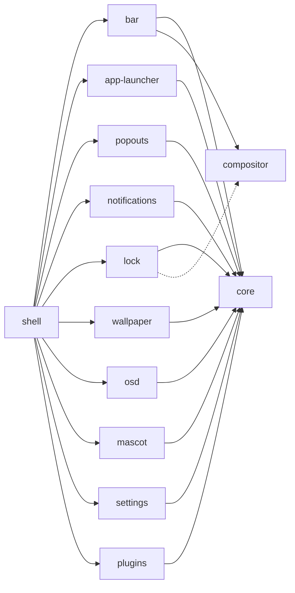

<h1 align="center">twilight-shell</h1>

<p align="center">
Рабочий стол для Wayland, собранный из частей: каждая живёт в своём репозитории и ставится отдельно.<br> Построен на <a href="https://quickshell.org">Quickshell</a> и нарисован как ночное небо над Понивиллем.
</p>

<p align="center">
  <a href="https://github.com/twilight-shell/shell/actions/workflows/ci.yml"></a>
  <a href="https://github.com/twilight-shell/shell/releases"></a>
  <a href="../../LICENSE"></a>
</p>

<!-- lang:start -->
<p align="center">
  <a href="../../README.md">English</a> ·
  <b>Русский</b> ·
  <a href="README.uk.md">Українська</a> ·
  <a href="README.de.md">Deutsch</a> ·
  <a href="README.fr.md">Français</a> ·
  <a href="README.es.md">Español</a> ·
  <a href="README.pt-BR.md">Português</a> ·
  <a href="README.it.md">Italiano</a> ·
  <a href="README.zh-CN.md">简体中文</a> ·
  <a href="README.ja.md">日本語</a> ·
  <a href="README.ko.md">한국어</a>
</p>
<!-- lang:end -->

<p align="center">
  
</p>

## Содержание

<!-- toc:start -->
- [Что это](#что-это)
- [Превью](#превью)
- [Скриншоты](#скриншоты)
  - [Бар](#бар)
  - [Лаунчер](#лаунчер)
  - [Всплывающие карточки](#всплывающие-карточки)
  - [Уведомления и индикатор громкости](#уведомления-и-индикатор-громкости)
  - [Экран блокировки](#экран-блокировки)
  - [Маскот](#маскот)
  - [Обои и палитры](#обои-и-палитры)
  - [Окно настроек](#окно-настроек)
  - [Плагины](#плагины)
- [Требования](#требования)
- [Установка](#установка)
- [Запуск](#запуск)
- [Использование](#использование)
- [Настройки](#настройки)
- [Компоненты](#компоненты)
- [Плагины](#плагины-1)
- [Решение проблем](#решение-проблем)
- [Обновление](#обновление)
- [Участие в проекте](#участие-в-проекте)
- [Благодарности](#благодарности)
- [Лицензия](#лицензия)
<!-- toc:end -->

## Что это

Бар, лаунчер, уведомления, экран блокировки, обои, маскот, окно настроек и плагины, нарисованные в одном стиле «наклеек» с единой палитрой.

- **Части, а не монолит.** Каждый компонент это отдельный репозиторий, который работает сам по себе и ставится отдельно. Нужен только лаунчер? Ставьте только лаунчер. Не нравится бар? Не ставьте его. Этот репозиторий лишь собирает их вместе.
- **Настройки это обычные TOML-файлы** в `~/.config/twilight-shell/`: они создаются из значений по умолчанию при первом запуске компонента и применяются в момент сохранения. Или пользуйтесь окном настроек.
- **Расширяемость.** Плагин это папка с `plugin.toml` и немного QML. Он может рисовать окна, отвечать на IPC-вызовы, добавлять остров в бар и получать страницу в окне настроек.
- **Не привязан к одному композитору.** Сегодня он работает в [niri](https://github.com/YaLTeR/niri). Всё, что общается с композитором, проходит через один небольшой модуль, так что другие могут появиться.

## Превью

<p align="center">
  <a href="../../docs/media/preview.mp4"></a>
</p>

Короткая экскурсия: лаунчер, календарь и микшер звука, уведомления, индикатор громкости, окно настроек и экран блокировки. Нажмите на картинку, чтобы запустить видео.

## Скриншоты

### Бар

Плавающие острова вдоль верхней кромки каждого экрана: кнопка лаунчера, рабочие столы, активное окно, часы (24-часовые или AM/PM, с секундами или без), раскладка клавиатуры, трей и громкость. Плагины могут добавлять свои острова.


### Лаунчер

«Twilight's Library»: карточка-книга заклинаний на фоне ночного неба. Печатайте для поиска: он найдёт Firefox, даже если вы набрали его в неправильной раскладке.


### Всплывающие карточки

Карточки, которые выезжают из бара: календарь с фазой луны под часами и микшер звука под громкостью со всеми выходами, входами и приложениями.

 

### Уведомления и индикатор громкости

Демон уведомлений: действия, срочность, фитиль, который сгорает, пока карточка на экране, и карточки, которые уступают место всплывающим. И плашка, поднимающаяся от нижнего края при изменении громкости.


 

### Экран блокировки

Отдельный процесс, который существует, только пока сессия заблокирована: пароль проверяется через PAM, показывается раскладка клавиатуры, чтобы не набрать пароль не в той, а неверный пароль трясёт карточку.


### Маскот

Твайлайт живёт в углу экрана. Она прогуливается по нижнему краю, говорит в облачке, танцует под музыку, клюёт носом поздно ночью, и её можно поднять и бросить. Её спрайтов в репозитории нет: в репозитории [mascot](https://github.com/twilight-shell/mascot) есть скрипт, который их скачивает, с указанием авторов.

 

### Обои и палитры

Картинка, проявляющаяся растущим кругом, или LED-стена из дрейфующих мерцающих звёзд в цветах палитры. Палитра может быть готовой, вашей собственной или взятой с обоев:

  
  
  

### Окно настроек

Страница для каждого компонента, описывающего свои настройки: ничего не нужно регистрировать, а плагин получает свою страницу так же. На странице палитры можно создать собственную палитру с помощью выбора цвета.

 
 
 

### Плагины

 

## Требования

- [Quickshell](https://quickshell.org) 0.3 или новее (он приносит Qt 6).
- Wayland-композитор. Рабочие столы, активное окно и раскладка клавиатуры пока известны для [niri](https://github.com/YaLTeR/niri); экрану блокировки нужен `ext-session-lock-v1` (он есть в niri, Hyprland, Sway и других).
- PipeWire для микшера звука, индикатора громкости и острова громкости.
- PAM для экрана блокировки.
- `git` и `make`, чтобы установить из клона репозитория.
- По желанию: шрифт [Monocraft](https://github.com/IdreesInc/Monocraft) Nerd Font (без него используется системный) и `curl` для скрипта, который скачивает спрайты маскота.

## Установка

Всё целиком, вместе с оболочкой, которая всё собирает:

```sh
git clone --recurse-submodules git@github.com:twilight-shell/shell.git
cd shell
sudo make install        # the modules to /usr/lib/qt6/qml, twilight-shell to /usr/bin
```

`make install PREFIX=~/.local QMLDIR=~/.local/lib/qt6/qml` ставит всё в вашу домашнюю папку.

Чтобы поставить только часть компонентов, укажите какие, и то, что им нужно, поставится вместе с ними:

```sh
sudo make install ONLY="bar"                 # the bar, with core and compositor
sudo make install ONLY="app-launcher lock"   # two, with core
```

Без оболочки, которая их собирает (нет `twilight-shell` и `shell.qml`), каждый запускается сам по себе: `qs -p /path/to/bar`. Что нужно компоненту, написано в файле `DEPENDS` его репозитория, и его собственный `make install` сообщит, если чего-то не хватает.

Чтобы попробовать без установки, запустите из клона: `bin/twilight-shell`.

## Запуск

Запускайте вместе с сессией. В niri:

```kdl
spawn-at-startup "twilight-shell"

binds {
    Mod+P repeat=false { spawn "twilight-shell" "ipc" "call" "launcher" "toggle"; }
    Mod+S repeat=false { spawn "twilight-shell" "ipc" "call" "settings" "toggle"; }
    Mod+Alt+Shift+L repeat=false { spawn "twilight-shell" "lock"; }
}
```

Оболочка сама является демоном уведомлений, а имя в сессионной шине может принадлежать только одному демону: при переходе на неё остановите mako, dunst и подобные.

На NVIDIA запускайте с `__GL_YIELD=USLEEP` в окружении (`spawn-at-startup "env" "__GL_YIELD=USLEEP" "twilight-shell"`): иначе драйвер ждёт GPU в активном цикле и жжёт процессор на каждом кадре.

При первом запуске для каждого компонента создаётся файл настроек в `~/.config/twilight-shell/`. Картинки для обоев кладите в `~/Pictures/Wallpapers`. Для маскота один раз скачайте её спрайты:

```sh
modules/mascot/scripts/get-sprites.sh        # from the checkout; the folder can be changed in mascot.toml
```

## Использование

`twilight-shell ipc call ...` обращается к запущенной оболочке.

| | |
|---|---|
| `launcher toggle` | Открыть и закрыть лаунчер. |
| `popout toggle calendar` | Календарь; `sound` для микшера. |
| `settings toggle` | Окно настроек; `settings open <tab>` открывает вкладку. |
| `wallpaper next` | Следующая картинка; `prev`, `set <path>`, `palette <name>`, `live stars` (или `live ""`). |
| `mascot toggle` | Убрать её из виду и вернуть; `mascot say <text>` заставляет её говорить. |
| `plugins list` | Плагины и что с ними не так; `plugins scan`, `plugins reload`. |

Другие команды скрипта запуска:

| | |
|---|---|
| `twilight-shell lock` | Заблокировать сессию. Отдельный процесс, который завершается при разблокировке. |
| `twilight-shell lock preview` | Показать экран блокировки, ничего не блокируя. Esc закрывает его. |
| `twilight-shell config init` | Создать файл настроек для каждого компонента, у которого его ещё нет. |

## Настройки

Один TOML-файл на компонент в `~/.config/twilight-shell/`, применяется сразу после сохранения. Комментарии и разметка сохраняются, когда оболочка записывает значение. Окно и файлы редактируют одно и то же.

| Файл | Что внутри |
|---|---|
| `theme.toml` | `palette` (готовая, `wallpaper` или ваша), `wallpaper` и ваши собственные `[palettes.<name>]`. |
| `bar.toml` | `window-title` и `[clock]` с `hour24` и `seconds`. |
| `app-launcher.toml` | `terminal`, команда, запускающая терминальные приложения. |
| `lock.toml` | `pam`, PAM-сервис, по которому проверяется пароль. |
| `wallpaper.toml` | `dir`, `live` и `[stars]` с `dot`, `cell`, `speed` и `glow`. |
| `mascot.toml` | `enabled`, `sprites`, `music`, `sleep`, `chatter`. |
| `plugins.toml` | `dirs`, где искать плагины, и `enabled`, какие из них запущены. |

Собственная палитра это таблица в `theme.toml`:

```toml
palette = "mine"

[palettes.mine]
name = "Mine"
base = "#2a4b3a"        # tints the background and the surfaces
primary = "#9be3b0"     # primary, accent and secondary are used as they are
accent = "#f2b84b"
secondary = "#3f8f7a"
```

Ключи каждого компонента описаны в его README.

## Компоненты

Каждый компонент это отдельный репозиторий со своей версией. Этот репозиторий указывает каждому коммит, проверенный вместе с остальными.



| | |
|---|---|
| [core](https://github.com/twilight-shell/core) | Тема, палитры, набор «наклеек» для интерфейса, файлы настроек. Нужен всем остальным компонентам. |
| [compositor](https://github.com/twilight-shell/compositor) | Рабочие столы, активное окно и раскладка клавиатуры, одинаково для любого композитора (пока niri). |
| [bar](https://github.com/twilight-shell/bar) | Бар. |
| [app-launcher](https://github.com/twilight-shell/app-launcher) | «Twilight's Library», лаунчер приложений. |
| [popouts](https://github.com/twilight-shell/popouts) | Календарь и микшер звука, выезжающие из бара. |
| [notifications](https://github.com/twilight-shell/notifications) | Демон уведомлений и его карточки. |
| [lock](https://github.com/twilight-shell/lock) | Экран блокировки. |
| [wallpaper](https://github.com/twilight-shell/wallpaper) | Обои: картинка или живые звёзды. |
| [osd](https://github.com/twilight-shell/osd) | Индикатор громкости. |
| [mascot](https://github.com/twilight-shell/mascot) | Сама Твайлайт, гуляющая по нижнему краю. Её спрайты скачиваются отдельно. |
| [settings](https://github.com/twilight-shell/settings) | Окно настроек: собственные палитры и страница для каждого компонента, описывающего свои настройки. |
| [plugins](https://github.com/twilight-shell/plugins) | Находит плагины и запускает включённые. |
| [plugin-template](https://github.com/twilight-shell/plugin-template) | Плагин, с которого можно начать. |

## Плагины

Плагин это папка с `plugin.toml` и немного QML. Он может рисовать окна, отвечать на IPC-вызовы, добавлять остров в бар и иметь страницу в окне настроек. Ничего не запускается, пока вы не включите это в окне настроек или в `plugins.toml`. Начните с [plugin-template](https://github.com/twilight-shell/plugin-template), а как всё устроено, читайте в [plugins](https://github.com/twilight-shell/plugins).

```sh
git clone git@github.com:twilight-shell/plugin-template.git ~/.local/share/twilight-shell/plugins/my-plugin
```

Плагин это код, который работает с вашими правами, и песочницы нет. Включайте только те, которым доверяете.

## Решение проблем

**`module "Twilight.Core" is not installed`.** Модуля нет в папке, где ищет Qt. Запускайте из клона через `bin/twilight-shell` (он настраивает путь), установите модули (`make install`) или укажите в `QML_IMPORT_PATH` родительские папки модулей, полными путями через `:`. В fish пишите `$HOME`: он не раскрывает `~` после двоеточия.

**Нет уведомлений или они приходят от другой программы.** Именем `org.freedesktop.Notifications` может владеть только один демон. Остановите mako, dunst и подобные; mako возвращается сам через активацию D-Bus, когда имя свободно, поэтому уберите его автозапуск. Кто владеет именем: `busctl --user list | grep Notifications`.

**Процессор загружен на NVIDIA.** Запускайте оболочку с `__GL_YIELD=USLEEP` в окружении.

**Маскот не появляется.** Ей нужны спрайты: запустите `modules/mascot/scripts/get-sprites.sh` (или скрипт из репозитория mascot) и проверьте `sprites` в `mascot.toml`.

**У компонента нет страницы в окне настроек.** Окно находит файлы `*.schema.toml` компонентов в `QML_IMPORT_PATH` и в папке, куда установлены модули. У компонента без схемы страницы нет.

**Новый компонент или плагин не появляется.** Список папок модулей читается при запуске оболочки: перезапустите её. Добавленную или удалённую папку плагина оболочка замечает сама; `twilight-shell ipc call plugins list` покажет, что она видит.

**Экран остаётся заблокированным.** Если процесс блокировки умер, композитор оставляет сессию заблокированной, в этом и смысл. Переключитесь на TTY (Ctrl+Alt+F2), войдите и запустите блокировщик для этой сессии или перезапустите композитор.

## Обновление

```sh
git pull --recurse-submodules
sudo make install
qs -p /usr/share/twilight-shell kill && twilight-shell
```

У каждого репозитория своя версия ([семантическое версионирование](https://semver.org), тег `v0.1.0` для каждого релиза, `CHANGELOG.md` со списком изменений). Релиз оболочки это набор компонентов, проверенных вместе: подмодули указывают на их коммиты, а эта команда показывает версии:

```sh
git submodule foreach 'git describe --tags --always'
```

Чтобы удалить: `sudo make uninstall`.

## Участие в проекте

Отчёты об ошибках, идеи, документация и плагины приветствуются. Прочитайте [CONTRIBUTING.md](../../CONTRIBUTING.md), а если вы агент, то и [AGENTS.md](../../AGENTS.md). Мы следуем [Кодексу поведения](https://github.com/twilight-shell/.github/blob/main/CODE_OF_CONDUCT.md); о проблемах безопасности сообщайте приватно, см. [SECURITY.md](https://github.com/twilight-shell/.github/blob/main/SECURITY.md).

## Благодарности

Спрайты маскота не входят в этот проект: скрипт `get-sprites.sh` из репозитория mascot скачивает спрайты Твайлайт Спаркл из [Desktop Ponies](https://github.com/RoosterDragon/Desktop-Ponies), работы RoosterDragon и множества художников, которые нарисовали их и поделились под лицензией CC BY-NC-SA 3.0 ([авторы](https://github.com/RoosterDragon/Desktop-Ponies/blob/master/Content/credits.txt)). Спасибо. My Little Pony: Friendship is Magic © Hasbro; проект не связан с Hasbro и Desktop Ponies и не одобрен ими. Шрифт [Monocraft](https://github.com/IdreesInc/Monocraft) с символами Nerd Font.

## Лицензия

MIT, см. [LICENSE](../../LICENSE). Спрайты сохраняют свою лицензию, CC BY-NC-SA 3.0.
