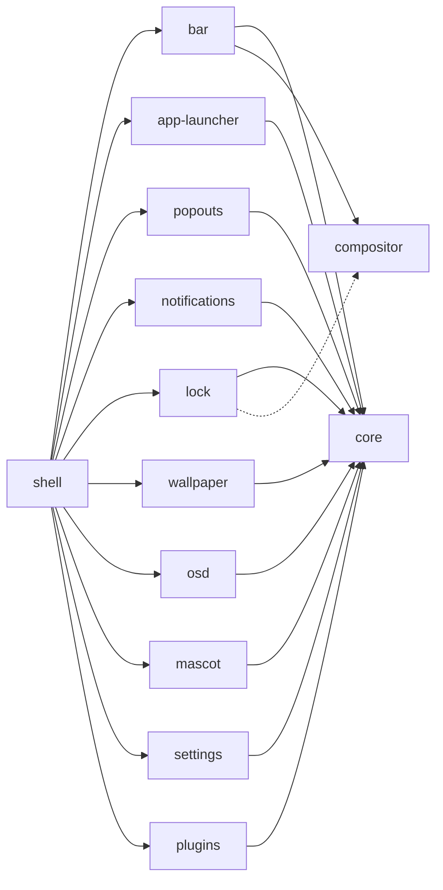

<h1 align="center">twilight-shell</h1>

<p align="center">
Робочий стіл для Wayland, зібраний із частин: кожна живе у власному репозиторії й встановлюється окремо.<br> Побудований на <a href="https://quickshell.org">Quickshell</a> і намальований як нічне небо над Понівілем.
</p>

<p align="center">
  <a href="https://github.com/twilight-shell/shell/actions/workflows/ci.yml"></a>
  <a href="https://github.com/twilight-shell/shell/releases"></a>
  <a href="../../LICENSE"></a>
</p>

<!-- lang:start -->
<p align="center">
  <a href="../../README.md">English</a> ·
  <a href="README.ru.md">Русский</a> ·
  <b>Українська</b> ·
  <a href="README.de.md">Deutsch</a> ·
  <a href="README.fr.md">Français</a> ·
  <a href="README.es.md">Español</a> ·
  <a href="README.pt-BR.md">Português</a> ·
  <a href="README.it.md">Italiano</a> ·
  <a href="README.zh-CN.md">简体中文</a> ·
  <a href="README.ja.md">日本語</a> ·
  <a href="README.ko.md">한국어</a>
</p>
<!-- lang:end -->

<p align="center">
  
</p>

## Зміст

<!-- toc:start -->
- [Що це](#що-це)
- [Превʼю](#превʼю)
- [Скриншоти](#скриншоти)
  - [Бар](#бар)
  - [Лаунчер](#лаунчер)
  - [Спливні картки](#спливні-картки)
  - [Сповіщення та індикатор гучності](#сповіщення-та-індикатор-гучності)
  - [Екран блокування](#екран-блокування)
  - [Маскот](#маскот)
  - [Шпалери та палітри](#шпалери-та-палітри)
  - [Вікно налаштувань](#вікно-налаштувань)
  - [Плагіни](#плагіни)
- [Вимоги](#вимоги)
- [Встановлення](#встановлення)
- [Запуск](#запуск)
- [Використання](#використання)
- [Налаштування](#налаштування)
- [Компоненти](#компоненти)
- [Плагіни](#плагіни-1)
- [Розв'язання проблем](#розвязання-проблем)
- [Оновлення](#оновлення)
- [Участь у проєкті](#участь-у-проєкті)
- [Подяки](#подяки)
- [Ліцензія](#ліцензія)
<!-- toc:end -->

## Що це

Бар, лаунчер, сповіщення, екран блокування, шпалери, маскот, вікно налаштувань і плагіни, намальовані в одному стилі «наліпок» з єдиною палітрою.

- **Частини, а не моноліт.** Кожен компонент це окремий репозиторій, який працює сам по собі й встановлюється окремо. Потрібен лише лаунчер? Встановлюйте лише лаунчер. Не подобається бар? Не встановлюйте його. Цей репозиторій лише збирає їх разом.
- **Налаштування це звичайні TOML-файли** в `~/.config/twilight-shell/`: вони створюються зі значень за замовчуванням під час першого запуску компонента й застосовуються в момент збереження. Або користуйтеся вікном налаштувань.
- **Розширюваність.** Плагін це тека з `plugin.toml` і трохи QML. Він може малювати вікна, відповідати на IPC-виклики, додавати острів у бар і отримувати сторінку у вікні налаштувань.
- **Не прив'язаний до одного композитора.** Сьогодні він працює в [niri](https://github.com/YaLTeR/niri). Усе, що спілкується з композитором, проходить через один невеликий модуль, тож інші можуть з'явитися.

## Превʼю

<p align="center">
  <a href="../../docs/media/preview.mp4"></a>
</p>

Коротка екскурсія: лаунчер, календар і мікшер звуку, сповіщення, індикатор гучності, вікно налаштувань та екран блокування. Натисніть на картинку, щоб запустити відео.

## Скриншоти

### Бар

Плаваючі острови вздовж верхнього краю кожного екрана: кнопка лаунчера, робочі столи, активне вікно, годинник (24-годинний або AM/PM, із секундами чи без), розкладка клавіатури, трей і гучність. Плагіни можуть додавати власні острови.


### Лаунчер

«Twilight's Library»: картка-книга заклинань на тлі нічного неба. Друкуйте для пошуку: він знайде Firefox, навіть якщо ви набрали його в неправильній розкладці.


### Спливні картки

Картки, що виїжджають із бара: календар із фазою місяця під годинником і мікшер звуку під гучністю з усіма виходами, входами та застосунками.

 

### Сповіщення та індикатор гучності

Демон сповіщень: дії, терміновість, гніт, що згоряє, поки картка на екрані, і картки, що поступаються місцем спливним. І плашка, що здіймається від нижнього краю, коли змінюється гучність.


 

### Екран блокування

Окремий процес, який існує лише поки сесію заблоковано: пароль перевіряється через PAM, показується розкладка клавіатури, щоб не набрати пароль не в тій, а неправильний пароль трясе картку.


### Маскот

Твайлайт живе в кутку екрана. Вона прогулюється нижнім краєм, говорить у хмарці, танцює під музику, куняє пізно вночі, і її можна підняти й кинути. Її спрайтів у репозиторії немає: у репозиторії [mascot](https://github.com/twilight-shell/mascot) є скрипт, який їх завантажує, із зазначенням авторів.

 

### Шпалери та палітри

Картинка, що проявляється зростаючим колом, або LED-стіна з дрейфуючих мерехтливих зірок у кольорах палітри. Палітра може бути готовою, вашою власною або взятою зі шпалер:

  
  
  

### Вікно налаштувань

Сторінка для кожного компонента, що описує свої налаштування: нічого не треба реєструвати, а плагін отримує свою сторінку так само. На сторінці палітри можна створити власну палітру за допомогою вибору кольору.

 
 
 

### Плагіни

 

## Вимоги

- [Quickshell](https://quickshell.org) 0.3 або новіший (він приносить Qt 6).
- Wayland-композитор. Робочі столи, активне вікно та розкладка клавіатури поки відомі для [niri](https://github.com/YaLTeR/niri); екрану блокування потрібен `ext-session-lock-v1` (він є в niri, Hyprland, Sway та інших).
- PipeWire для мікшера звуку, індикатора гучності та острова гучності.
- PAM для екрана блокування.
- `git` і `make`, щоб встановити з клону репозиторію.
- За бажанням: шрифт [Monocraft](https://github.com/IdreesInc/Monocraft) Nerd Font (без нього використовується системний) і `curl` для скрипта, що завантажує спрайти маскота.

## Встановлення

Усе разом, з оболонкою, що все збирає:

```sh
git clone --recurse-submodules git@github.com:twilight-shell/shell.git
cd shell
sudo make install        # the modules to /usr/lib/qt6/qml, twilight-shell to /usr/bin
```

`make install PREFIX=~/.local QMLDIR=~/.local/lib/qt6/qml` встановлює все у вашу домашню теку.

Щоб встановити лише частину компонентів, вкажіть які, і те, що їм потрібне, встановиться разом з ними:

```sh
sudo make install ONLY="bar"                 # the bar, with core and compositor
sudo make install ONLY="app-launcher lock"   # two, with core
```

Без оболонки, що їх збирає (немає `twilight-shell` і `shell.qml`), кожен запускається сам по собі: `qs -p /path/to/bar`. Що потрібно компоненту, написано у файлі `DEPENDS` його репозиторію, а його власний `make install` повідомить, якщо чогось бракує.

Щоб спробувати без встановлення, запустіть із клону: `bin/twilight-shell`.

## Запуск

Запускайте разом із сесією. У niri:

```kdl
spawn-at-startup "twilight-shell"

binds {
    Mod+P repeat=false { spawn "twilight-shell" "ipc" "call" "launcher" "toggle"; }
    Mod+S repeat=false { spawn "twilight-shell" "ipc" "call" "settings" "toggle"; }
    Mod+Alt+Shift+L repeat=false { spawn "twilight-shell" "lock"; }
}
```

Оболонка сама є демоном сповіщень, а ім'я в сесійній шині може належати лише одному демону: під час переходу на неї зупиніть mako, dunst і подібні.

На NVIDIA запускайте з `__GL_YIELD=USLEEP` в оточенні (`spawn-at-startup "env" "__GL_YIELD=USLEEP" "twilight-shell"`): інакше драйвер чекає GPU в активному циклі й палить процесор на кожному кадрі.

Під час першого запуску для кожного компонента створюється файл налаштувань у `~/.config/twilight-shell/`. Картинки для шпалер кладіть у `~/Pictures/Wallpapers`. Для маскота один раз завантажте її спрайти:

```sh
modules/mascot/scripts/get-sprites.sh        # from the checkout; the folder can be changed in mascot.toml
```

## Використання

`twilight-shell ipc call ...` звертається до запущеної оболонки.

| | |
|---|---|
| `launcher toggle` | Відкрити й закрити лаунчер. |
| `popout toggle calendar` | Календар; `sound` для мікшера. |
| `settings toggle` | Вікно налаштувань; `settings open <tab>` відкриває вкладку. |
| `wallpaper next` | Наступна картинка; `prev`, `set <path>`, `palette <name>`, `live stars` (або `live ""`). |
| `mascot toggle` | Прибрати її з очей і повернути; `mascot say <text>` змушує її говорити. |
| `plugins list` | Плагіни та що з ними не так; `plugins scan`, `plugins reload`. |

Інші команди скрипта запуску:

| | |
|---|---|
| `twilight-shell lock` | Заблокувати сесію. Окремий процес, що завершується після розблокування. |
| `twilight-shell lock preview` | Показати екран блокування, нічого не блокуючи. Esc закриває його. |
| `twilight-shell config init` | Створити файл налаштувань для кожного компонента, у якого його ще немає. |

## Налаштування

Один TOML-файл на компонент у `~/.config/twilight-shell/`, застосовується одразу після збереження. Коментарі та розмітка зберігаються, коли оболонка записує значення. Вікно й файли редагують те саме.

| Файл | Що всередині |
|---|---|
| `theme.toml` | `palette` (готова, `wallpaper` або ваша), `wallpaper` та ваші власні `[palettes.<name>]`. |
| `bar.toml` | `window-title` і `[clock]` з `hour24` та `seconds`. |
| `app-launcher.toml` | `terminal`, команда, що запускає термінальні застосунки. |
| `lock.toml` | `pam`, PAM-сервіс, за яким перевіряється пароль. |
| `wallpaper.toml` | `dir`, `live` і `[stars]` з `dot`, `cell`, `speed` та `glow`. |
| `mascot.toml` | `enabled`, `sprites`, `music`, `sleep`, `chatter`. |
| `plugins.toml` | `dirs`, де шукати плагіни, і `enabled`, які з них запущені. |

Власна палітра це таблиця в `theme.toml`:

```toml
palette = "mine"

[palettes.mine]
name = "Mine"
base = "#2a4b3a"        # tints the background and the surfaces
primary = "#9be3b0"     # primary, accent and secondary are used as they are
accent = "#f2b84b"
secondary = "#3f8f7a"
```

Ключі кожного компонента описано в його README.

## Компоненти

Кожен компонент це окремий репозиторій зі своєю версією. Цей репозиторій вказує кожному коміт, перевірений разом з іншими.



| | |
|---|---|
| [core](https://github.com/twilight-shell/core) | Тема, палітри, набір «наліпок» для інтерфейсу, файли налаштувань. Потрібен усім іншим компонентам. |
| [compositor](https://github.com/twilight-shell/compositor) | Робочі столи, активне вікно та розкладка клавіатури, однаково для будь-якого композитора (поки niri). |
| [bar](https://github.com/twilight-shell/bar) | Бар. |
| [app-launcher](https://github.com/twilight-shell/app-launcher) | «Twilight's Library», лаунчер застосунків. |
| [popouts](https://github.com/twilight-shell/popouts) | Календар і мікшер звуку, що виїжджають із бара. |
| [notifications](https://github.com/twilight-shell/notifications) | Демон сповіщень і його картки. |
| [lock](https://github.com/twilight-shell/lock) | Екран блокування. |
| [wallpaper](https://github.com/twilight-shell/wallpaper) | Шпалери: картинка або живі зірки. |
| [osd](https://github.com/twilight-shell/osd) | Індикатор гучності. |
| [mascot](https://github.com/twilight-shell/mascot) | Сама Твайлайт, що гуляє нижнім краєм. Її спрайти завантажуються окремо. |
| [settings](https://github.com/twilight-shell/settings) | Вікно налаштувань: власні палітри та сторінка для кожного компонента, що описує свої налаштування. |
| [plugins](https://github.com/twilight-shell/plugins) | Знаходить плагіни й запускає ввімкнені. |
| [plugin-template](https://github.com/twilight-shell/plugin-template) | Плагін, з якого можна почати. |

## Плагіни

Плагін це тека з `plugin.toml` і трохи QML. Він може малювати вікна, відповідати на IPC-виклики, додавати острів у бар і мати сторінку у вікні налаштувань. Нічого не запускається, доки ви не ввімкнете це у вікні налаштувань або в `plugins.toml`. Почніть з [plugin-template](https://github.com/twilight-shell/plugin-template), а як усе влаштовано, читайте в [plugins](https://github.com/twilight-shell/plugins).

```sh
git clone git@github.com:twilight-shell/plugin-template.git ~/.local/share/twilight-shell/plugins/my-plugin
```

Плагін це код, який працює з вашими правами, і пісочниці немає. Вмикайте лише ті, яким довіряєте.

## Розв'язання проблем

**`module "Twilight.Core" is not installed`.** Модуля немає в теці, де шукає Qt. Запускайте з клону через `bin/twilight-shell` (він налаштовує шлях), встановіть модулі (`make install`) або вкажіть у `QML_IMPORT_PATH` батьківські теки модулів повними шляхами через `:`. У fish пишіть `$HOME`: він не розкриває `~` після двокрапки.

**Немає сповіщень або вони приходять від іншої програми.** Ім'ям `org.freedesktop.Notifications` може володіти лише один демон. Зупиніть mako, dunst і подібні; mako повертається сам через активацію D-Bus, коли ім'я вільне, тому приберіть його автозапуск. Хто володіє ім'ям: `busctl --user list | grep Notifications`.

**Процесор завантажений на NVIDIA.** Запускайте оболонку з `__GL_YIELD=USLEEP` в оточенні.

**Маскот не з'являється.** Їй потрібні спрайти: запустіть `modules/mascot/scripts/get-sprites.sh` (або скрипт із репозиторію mascot) і перевірте `sprites` у `mascot.toml`.

**У компонента немає сторінки у вікні налаштувань.** Вікно знаходить файли `*.schema.toml` компонентів у `QML_IMPORT_PATH` і в теці, куди встановлено модулі. У компонента без схеми сторінки немає.

**Новий компонент або плагін не з'являється.** Список тек модулів читається під час запуску оболонки: перезапустіть її. Додану чи видалену теку плагіна оболонка помічає сама; `twilight-shell ipc call plugins list` покаже, що вона бачить.

**Екран залишається заблокованим.** Якщо процес блокування помер, композитор залишає сесію заблокованою, у цьому й сенс. Перейдіть на TTY (Ctrl+Alt+F2), увійдіть і запустіть блокувальник для цієї сесії або перезапустіть композитор.

## Оновлення

```sh
git pull --recurse-submodules
sudo make install
qs -p /usr/share/twilight-shell kill && twilight-shell
```

Кожен репозиторій має власну версію ([семантичне версіювання](https://semver.org), тег `v0.1.0` для кожного релізу, `CHANGELOG.md` зі списком змін). Реліз оболонки це набір компонентів, перевірених разом: підмодулі вказують на їхні коміти, а ця команда показує версії:

```sh
git submodule foreach 'git describe --tags --always'
```

Щоб видалити: `sudo make uninstall`.

## Участь у проєкті

Звіти про помилки, ідеї, документація та плагіни вітаються. Прочитайте [CONTRIBUTING.md](../../CONTRIBUTING.md), а якщо ви агент, то й [AGENTS.md](../../AGENTS.md). Ми дотримуємося [Кодексу поведінки](https://github.com/twilight-shell/.github/blob/main/CODE_OF_CONDUCT.md); про проблеми безпеки повідомляйте приватно, див. [SECURITY.md](https://github.com/twilight-shell/.github/blob/main/SECURITY.md).

## Подяки

Спрайти маскота не входять до цього проєкту: скрипт `get-sprites.sh` із репозиторію mascot завантажує спрайти Твайлайт Спаркл із [Desktop Ponies](https://github.com/RoosterDragon/Desktop-Ponies), роботи RoosterDragon і багатьох художників, які намалювали їх і поділилися під ліцензією CC BY-NC-SA 3.0 ([автори](https://github.com/RoosterDragon/Desktop-Ponies/blob/master/Content/credits.txt)). Дякуємо. My Little Pony: Friendship is Magic © Hasbro; проєкт не пов'язаний із Hasbro і Desktop Ponies і не схвалений ними. Шрифт [Monocraft](https://github.com/IdreesInc/Monocraft) із символами Nerd Font.

## Ліцензія

MIT, див. [LICENSE](../../LICENSE). Спрайти зберігають свою ліцензію, CC BY-NC-SA 3.0.
