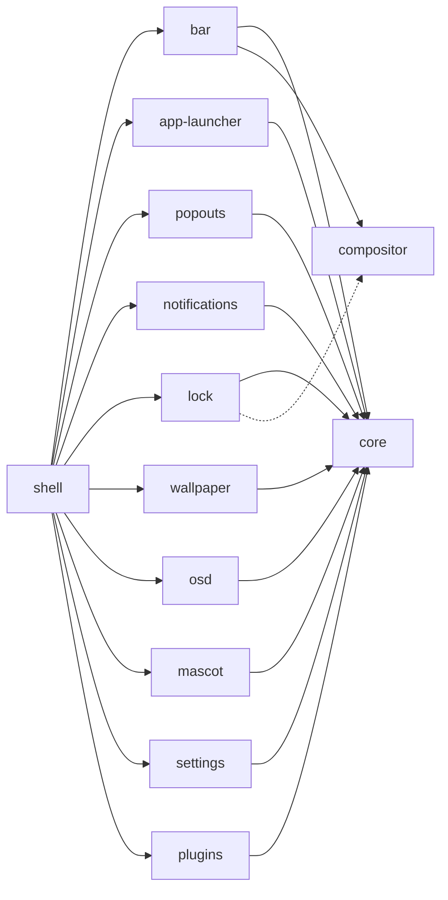

<h1 align="center">twilight-shell</h1>

<p align="center">
一个面向 Wayland 的桌面 Shell，由一块块各自独立的部分组成：每个部分有自己的仓库，也可以单独安装。<br> 基于 <a href="https://quickshell.org">Quickshell</a> 构建，画得像小马镇上空的夜空。
</p>

<p align="center">
  <a href="https://github.com/twilight-shell/shell/actions/workflows/ci.yml"></a>
  <a href="https://github.com/twilight-shell/shell/releases"></a>
  <a href="../../LICENSE"></a>
</p>

<!-- lang:start -->
<p align="center">
  <a href="../../README.md">English</a> ·
  <a href="README.ru.md">Русский</a> ·
  <a href="README.uk.md">Українська</a> ·
  <a href="README.de.md">Deutsch</a> ·
  <a href="README.fr.md">Français</a> ·
  <a href="README.es.md">Español</a> ·
  <a href="README.pt-BR.md">Português</a> ·
  <a href="README.it.md">Italiano</a> ·
  <b>简体中文</b> ·
  <a href="README.ja.md">日本語</a> ·
  <a href="README.ko.md">한국어</a>
</p>
<!-- lang:end -->

<p align="center">
  
</p>

## 目录

<!-- toc:start -->
- [这是什么](#这是什么)
- [预览](#预览)
- [截图](#截图)
  - [状态栏](#状态栏)
  - [启动器](#启动器)
  - [弹出卡片](#弹出卡片)
  - [通知和音量提示](#通知和音量提示)
  - [锁屏](#锁屏)
  - [吉祥物](#吉祥物)
  - [壁纸和配色](#壁纸和配色)
  - [设置窗口](#设置窗口)
  - [插件](#插件)
- [系统要求](#系统要求)
- [安装](#安装)
- [运行](#运行)
- [使用](#使用)
- [设置](#设置)
- [组件](#组件)
- [插件](#插件-1)
- [故障排查](#故障排查)
- [更新](#更新)
- [参与贡献](#参与贡献)
- [致谢](#致谢)
- [许可证](#许可证)
<!-- toc:end -->

## 这是什么

一个状态栏、一个启动器、通知、锁屏、壁纸、一个吉祥物、一个设置窗口和插件，全部采用同一种贴纸风格，并遵循同一套配色。

- **是零件，不是整块。** 每个组件都是独立的仓库，可以单独运行，也可以单独安装。只想要启动器？只装启动器。不喜欢状态栏？不装它。这个仓库只负责把它们组装在一起。
- **设置是普通的 TOML 文件**，位于 `~/.config/twilight-shell/`：组件首次运行时按默认值生成，保存后立即生效。也可以使用设置窗口。
- **可扩展。** 插件是一个包含 `plugin.toml` 和一些 QML 的文件夹。它可以绘制窗口、响应 IPC 调用、在状态栏里放一个岛，并在设置窗口里拥有自己的页面。
- **不绑定某一个合成器。** 目前它运行在 [niri](https://github.com/YaLTeR/niri) 上。所有与合成器打交道的部分都经过一个小模块，因此其他合成器也可以跟进。

## 预览

<p align="center">
  <a href="../../docs/media/preview.mp4"></a>
</p>

简短的导览：启动器、日历和音量混音器、通知、音量提示、设置窗口和锁屏。点击图片播放视频。

## 截图

### 状态栏

沿着每块屏幕顶端浮动的小岛：启动器按钮、工作区、当前窗口、时钟（24 小时制或 AM/PM，可带秒）、键盘布局、托盘和音量。插件可以添加自己的岛。


### 启动器

“Twilight's Library”：夜空之上的魔法书卡片。输入即可搜索，即使你用错了键盘布局输入，它也能找到 Firefox。


### 弹出卡片

从状态栏落下的卡片：时钟下方带月相的日历，以及音量下方列出所有输出、输入和应用的混音器。

 

### 通知和音量提示

通知守护进程：支持操作、紧急程度、卡片显示期间逐渐烧短的引线，以及会为弹出卡片让位的卡片。还有音量变化时从底边升起的提示。


 

### 锁屏

一个独立的进程，只在会话被锁定时存在：密码通过 PAM 验证，会显示键盘布局以免输错，输错密码时卡片会抖动。


### 吉祥物

Twilight 住在屏幕的一角。她沿着底边散步，用气泡说话，音乐响起时跳舞，深夜打瞌睡，还可以被拎起来扔出去。她的精灵图不在仓库里：[mascot](https://github.com/twilight-shell/mascot) 仓库有一个脚本负责下载，并附有作者信息。

 

### 壁纸和配色

图片由不断扩大的圆圈揭示出来，或者是一面 LED 墙，漂移闪烁的星星采用配色的颜色。配色可以是现成的、你自己的，或者取自壁纸的颜色：

  
  
  

### 设置窗口

每个描述自己设置的组件都有一个页面：无需注册，插件也用同样的方式获得页面。在配色页面，你可以用取色器创建自己的配色。

 
 
 

### 插件

 

## 系统要求

- [Quickshell](https://quickshell.org) 0.3 或更新版本（它带来 Qt 6）。
- 一个 Wayland 合成器。工作区、当前窗口和键盘布局目前只支持 [niri](https://github.com/YaLTeR/niri)；锁屏需要 `ext-session-lock-v1`（niri、Hyprland、Sway 等都有）。
- PipeWire，用于音量混音器、音量提示和音量岛。
- PAM，用于锁屏。
- `git` 和 `make`，用于从克隆的仓库安装。
- 可选：[Monocraft](https://github.com/IdreesInc/Monocraft) Nerd Font 字体（没有它就使用系统字体），以及 `curl`，用于下载吉祥物精灵图的脚本。

## 安装

全部安装，包括把它们组装起来的 shell：

```sh
git clone --recurse-submodules git@github.com:twilight-shell/shell.git
cd shell
sudo make install        # the modules to /usr/lib/qt6/qml, twilight-shell to /usr/bin
```

`make install PREFIX=~/.local QMLDIR=~/.local/lib/qt6/qml` 会把所有内容装到你的主目录。

只安装部分组件时，说明是哪些，它们所需的依赖会一并安装：

```sh
sudo make install ONLY="bar"                 # the bar, with core and compositor
sudo make install ONLY="app-launcher lock"   # two, with core
```

没有负责组装的 shell（没有 `twilight-shell`，也没有 `shell.qml`）时，每个组件都能独立运行：`qs -p /path/to/bar`。组件需要什么写在它仓库的 `DEPENDS` 文件里，它自己的 `make install` 也会在缺少东西时提示。

不安装直接试用，从克隆的仓库运行：`bin/twilight-shell`。

## 运行

随会话启动。在 niri 中：

```kdl
spawn-at-startup "twilight-shell"

binds {
    Mod+P repeat=false { spawn "twilight-shell" "ipc" "call" "launcher" "toggle"; }
    Mod+S repeat=false { spawn "twilight-shell" "ipc" "call" "settings" "toggle"; }
    Mod+Alt+Shift+L repeat=false { spawn "twilight-shell" "lock"; }
}
```

这个 shell 本身就是通知守护进程，而会话总线上的名称只能属于一个守护进程：切换过来时请停掉 mako、dunst 之类。

在 NVIDIA 上，请在环境中设置 `__GL_YIELD=USLEEP` 启动（`spawn-at-startup "env" "__GL_YIELD=USLEEP" "twilight-shell"`）：否则驱动会忙等 GPU，每一帧都在消耗 CPU。

首次启动会在 `~/.config/twilight-shell/` 中为每个组件生成设置文件。壁纸图片放在 `~/Pictures/Wallpapers`。吉祥物的精灵图需要下载一次：

```sh
modules/mascot/scripts/get-sprites.sh        # from the checkout; the folder can be changed in mascot.toml
```

## 使用

`twilight-shell ipc call ...` 与正在运行的 shell 通信。

| | |
|---|---|
| `launcher toggle` | 打开和关闭启动器。 |
| `popout toggle calendar` | 日历；`sound` 为混音器。 |
| `settings toggle` | 设置窗口；`settings open <tab>` 打开某个标签页。 |
| `wallpaper next` | 下一张图片；还有 `prev`、`set <path>`、`palette <name>`、`live stars`（或 `live ""`）。 |
| `mascot toggle` | 让她离开视线再回来；`mascot say <text>` 让她说话。 |
| `plugins list` | 插件及其问题；`plugins scan`、`plugins reload`。 |

启动脚本的其他命令：

| | |
|---|---|
| `twilight-shell lock` | 锁定会话。这是一个独立进程，解锁后退出。 |
| `twilight-shell lock preview` | 显示锁屏但不锁定任何东西。按 Esc 关闭。 |
| `twilight-shell config init` | 为尚无设置文件的每个组件生成设置文件。 |

## 设置

每个组件在 `~/.config/twilight-shell/` 中有一个 TOML 文件，保存后立即生效。shell 回写数值时会保留注释和排版。设置窗口和文件编辑的是同一份内容。

| 文件 | 内容 |
|---|---|
| `theme.toml` | `palette`（现成的、`wallpaper`，或你自己的）、`wallpaper`，以及你自己的 `[palettes.<name>]`。 |
| `bar.toml` | `window-title`，以及带有 `hour24` 和 `seconds` 的 `[clock]`。 |
| `app-launcher.toml` | `terminal`，运行终端应用的命令。 |
| `lock.toml` | `pam`，用来验证密码的 PAM 服务。 |
| `wallpaper.toml` | `dir`、`live`，以及带有 `dot`、`cell`、`speed` 和 `glow` 的 `[stars]`。 |
| `mascot.toml` | `enabled`、`sprites`、`music`、`sleep`、`chatter`。 |
| `plugins.toml` | `dirs`（查找插件的位置）和 `enabled`（运行哪些插件）。 |

自定义配色是 `theme.toml` 中的一张表：

```toml
palette = "mine"

[palettes.mine]
name = "Mine"
base = "#2a4b3a"        # tints the background and the surfaces
primary = "#9be3b0"     # primary, accent and secondary are used as they are
accent = "#f2b84b"
secondary = "#3f8f7a"
```

每个组件的键都写在它自己的 README 里。

## 组件

每个组件都是自己的仓库，各有自己的版本。这个仓库让每个组件指向与其他组件一起测试过的那次提交。



| | |
|---|---|
| [core](https://github.com/twilight-shell/core) | 主题、配色、贴纸界面工具包、设置文件。所有其他组件都需要它。 |
| [compositor](https://github.com/twilight-shell/compositor) | 工作区、当前窗口和键盘布局，对任何合成器都一样（目前是 niri）。 |
| [bar](https://github.com/twilight-shell/bar) | 状态栏。 |
| [app-launcher](https://github.com/twilight-shell/app-launcher) | “Twilight's Library”，应用启动器。 |
| [popouts](https://github.com/twilight-shell/popouts) | 从状态栏落下的日历和音量混音器。 |
| [notifications](https://github.com/twilight-shell/notifications) | 通知守护进程及其卡片。 |
| [lock](https://github.com/twilight-shell/lock) | 锁屏。 |
| [wallpaper](https://github.com/twilight-shell/wallpaper) | 壁纸，图片或动态星空。 |
| [osd](https://github.com/twilight-shell/osd) | 音量提示。 |
| [mascot](https://github.com/twilight-shell/mascot) | Twilight 本人，沿着底边散步。她的精灵图单独下载。 |
| [settings](https://github.com/twilight-shell/settings) | 设置窗口：自定义配色，以及每个描述自己设置的组件的页面。 |
| [plugins](https://github.com/twilight-shell/plugins) | 查找插件并运行已启用的插件。 |
| [plugin-template](https://github.com/twilight-shell/plugin-template) | 一个可以作为起点的插件。 |

## 插件

插件是一个包含 `plugin.toml` 和一些 QML 的文件夹。它可以绘制窗口、响应 IPC 调用、在状态栏里放一个岛，并在设置窗口里拥有页面。除非你在设置窗口或 `plugins.toml` 中启用，否则什么都不会运行。从 [plugin-template](https://github.com/twilight-shell/plugin-template) 开始，并在 [plugins](https://github.com/twilight-shell/plugins) 中了解一切如何工作。

```sh
git clone git@github.com:twilight-shell/plugin-template.git ~/.local/share/twilight-shell/plugins/my-plugin
```

插件是以你的权限运行的代码，没有沙箱。只启用你信任的插件。

## 故障排查

**`module "Twilight.Core" is not installed`。** 模块不在 Qt 搜索的文件夹里。从克隆的仓库用 `bin/twilight-shell` 运行（它会设好路径），安装模块（`make install`），或者让 `QML_IMPORT_PATH` 指向模块的上级文件夹，使用完整路径并以 `:` 分隔。在 fish 中请写 `$HOME`：它不会展开冒号后的 `~`。

**没有通知，或者通知来自别的程序。** 只有一个守护进程能拥有 `org.freedesktop.Notifications`。请停掉 mako、dunst 之类；名称空闲时 mako 会通过 D-Bus 激活自己回来，所以要去掉它的自启动。查看谁占有这个名称：`busctl --user list | grep Notifications`。

**NVIDIA 上 CPU 占用高。** 在环境中设置 `__GL_YIELD=USLEEP` 启动 shell。

**吉祥物没有出现。** 她需要精灵图：运行 `modules/mascot/scripts/get-sprites.sh`（或 mascot 仓库里的那个），并检查 `mascot.toml` 中的 `sprites`。

**某个组件在设置窗口里没有页面。** 窗口会在 `QML_IMPORT_PATH` 和模块安装所在的文件夹中查找组件的 `*.schema.toml` 文件。没有 schema 的组件就没有页面。

**新组件或插件没有出现。** 模块文件夹列表在 shell 启动时读取：请重启它。新增或删除的插件文件夹会被自动发现；`twilight-shell ipc call plugins list` 会告诉你它看到了什么。

**屏幕一直处于锁定状态。** 如果锁屏进程死掉，合成器会保持会话锁定，这正是它的用意。切换到 TTY（Ctrl+Alt+F2），登录，然后为该会话启动一个锁屏程序，或者重启合成器。

## 更新

```sh
git pull --recurse-submodules
sudo make install
qs -p /usr/share/twilight-shell kill && twilight-shell
```

每个仓库都有自己的版本（[语义化版本](https://semver.org)，每次发布一个标签 `v0.1.0`，以及说明改动内容的 `CHANGELOG.md`）。shell 的一次发布是一组一起测试过的组件：子模块指向它们的提交，下面的命令会显示它们的版本：

```sh
git submodule foreach 'git describe --tags --always'
```

卸载：`sudo make uninstall`。

## 参与贡献

欢迎提交 bug 报告、想法、文档和插件。请阅读 [CONTRIBUTING.md](../../CONTRIBUTING.md)，如果你是智能体，还请阅读 [AGENTS.md](../../AGENTS.md)。我们遵守[行为准则](https://github.com/twilight-shell/.github/blob/main/CODE_OF_CONDUCT.md)；安全问题请私下报告，见 [SECURITY.md](https://github.com/twilight-shell/.github/blob/main/SECURITY.md)。

## 致谢

吉祥物的精灵图不属于本项目：mascot 仓库的 `get-sprites.sh` 脚本会从 [Desktop Ponies](https://github.com/RoosterDragon/Desktop-Ponies) 下载 Twilight Sparkle 的图，这是 RoosterDragon 和许多绘制并以 CC BY-NC-SA 3.0 分享它们的艺术家的作品（[署名](https://github.com/RoosterDragon/Desktop-Ponies/blob/master/Content/credits.txt)）。谢谢。My Little Pony: Friendship is Magic © Hasbro；本项目与 Hasbro 和 Desktop Ponies 无关联，也未获得其认可。字体是 [Monocraft](https://github.com/IdreesInc/Monocraft)，已打上 Nerd Font 符号补丁。

## 许可证

MIT，见 [LICENSE](../../LICENSE)。精灵图保留其自己的许可证 CC BY-NC-SA 3.0。
